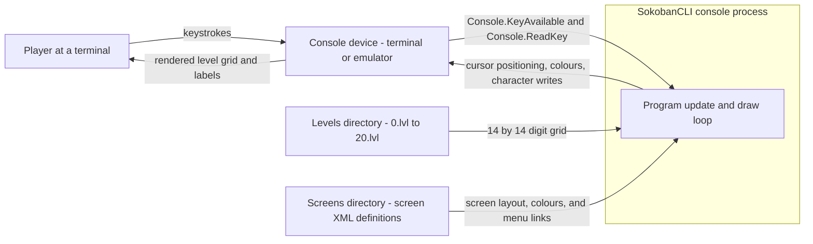
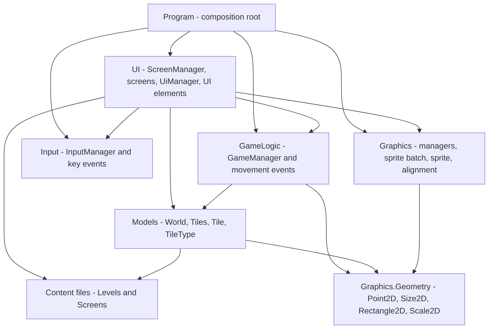
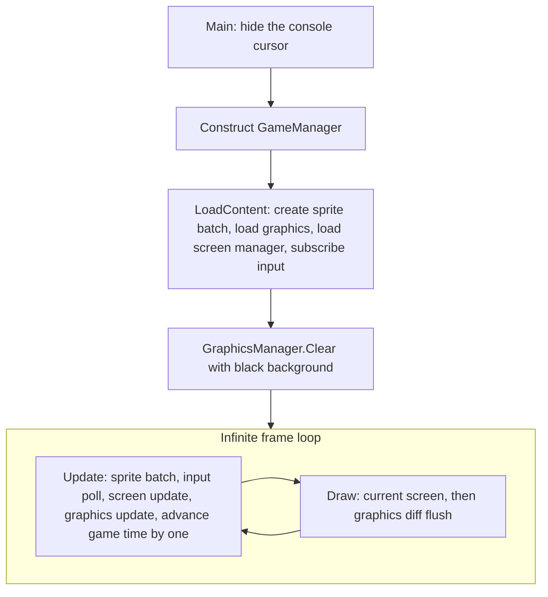
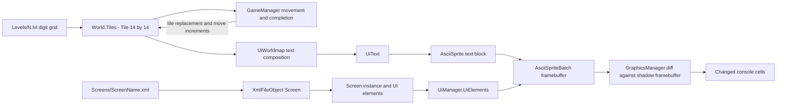
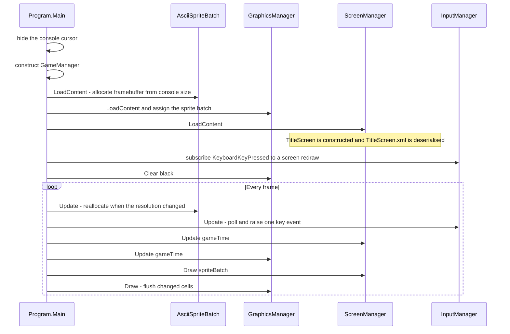
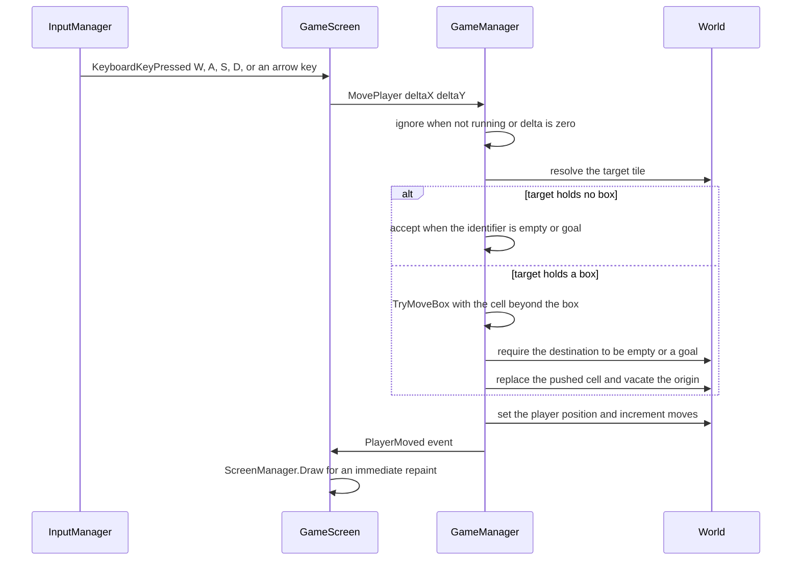
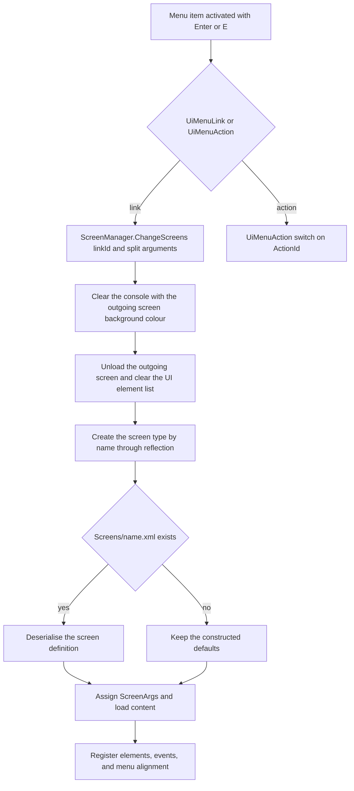
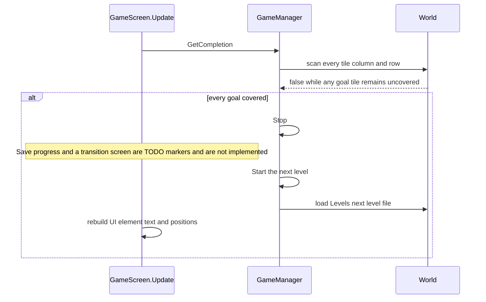
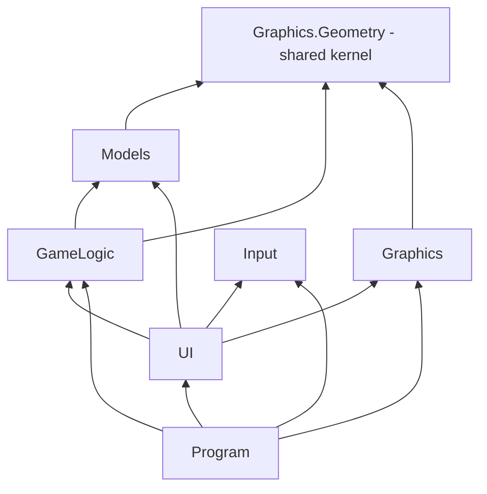

# SokobanCLI Architecture

This document describes the currently implemented architecture of the SokobanCLI terminal puzzle game as it exists on the `master` branch: its boundaries, components, ownership rules, runtime behaviour, data, dependencies, and the constraints a contributor must respect. It documents present state and does not describe an idealised redesign; intended work that is not implemented is labelled as such.

## 📑 Table of Contents

- [Purpose](#purpose)
- [System Context](#system-context)
- [Architectural Style](#architectural-style)
- [Runtime Process](#runtime-process)
- [Components](#components)
- [Architectural Areas](#architectural-areas)
  - [Application Entry Point](#application-entry-point)
  - [Game Logic](#game-logic)
  - [Models](#models)
  - [Graphics](#graphics)
  - [Input](#input)
  - [User Interface](#user-interface)
  - [Content](#content)
  - [Verification](#verification)
- [Data Architecture](#data-architecture)
- [Interfaces and Integrations](#interfaces-and-integrations)
- [Key Processes](#key-processes)
  - [Application Startup](#application-startup)
  - [Player Movement and Box Pushing](#player-movement-and-box-pushing)
  - [Screen Navigation](#screen-navigation)
  - [Level Completion and Advancement](#level-completion-and-advancement)
- [Level Format and Tile Encoding](#level-format-and-tile-encoding)
- [ASCII Rendering and Wall Shapes](#ascii-rendering-and-wall-shapes)
- [Cross-Cutting Concerns](#cross-cutting-concerns)
  - [Security and Privacy](#security-and-privacy)
  - [Error Handling](#error-handling)
  - [Observability](#observability)
  - [Configuration](#configuration)
  - [Concurrency and Resource Use](#concurrency-and-resource-use)
- [Dependency Direction and Rules](#dependency-direction-and-rules)
- [External Dependencies](#external-dependencies)
- [Deployment and Operations](#deployment-and-operations)
- [Compatibility Contracts](#compatibility-contracts)
- [Testing and Verification](#testing-and-verification)
- [Design Constraints](#design-constraints)
- [Extension Points](#extension-points)
  - [Additional Screen](#additional-screen)
  - [Additional UI Element](#additional-ui-element)
  - [Additional Level](#additional-level)
- [Evolution and Migration](#evolution-and-migration)
  - [Current State](#current-state)
  - [Target State](#target-state)
  - [Transition](#transition)
- [Architecture Decisions](#architecture-decisions)
- [Source Map](#source-map)
- [Related Documentation](#related-documentation)

## 🎯 Purpose

SokobanCLI is a single-process, interactive terminal application that plays the classic Sokoban box-pushing puzzle. Its principal responsibility is to present a level grid in the console, translate keyboard input into validated player and box movement, detect level completion, and advance to the next level.

The documented audience is a contributor who needs to locate the owner of a behaviour, follow a move from key press to rendered cell, and judge the impact of a change. The architectural interest lies in a small set of boundaries — a composition root, a game-logic manager, an in-memory world model, a diff-based console renderer, a polling input manager, and an XML-driven screen/UI layer — that are enforced by an automated architecture test project rather than by project separation.

Out of scope: installation and usage guidance, which the [README](./README.md) owns, and the external release helper invoked by `release.sh`.

## 🌐 System Context

SokobanCLI is a self-contained console process. It has no network, service, or database boundary. Everything it consumes is either the console device or content files shipped beside the executable, and the only durable artefacts it produces are console output and the build/release artefacts created by the toolchain.



The principal external boundaries are:
- **Console device:** Bidirectional. SokobanCLI polls for available keystrokes and writes individual cells with explicit cursor position and colours. The device owns buffering, echo, and window sizing; the application owns cell content and colour selection.
- **Level content:** Inbound only. `Levels/*.lvl` files are read through the file system by the world model, relative to the process working directory. The repository owns the files; the application treats them as read-only input.
- **Screen definitions:** Inbound only. `Screens/*.xml` files are deserialised into screen objects by the screen manager. The repository owns the definitions.
- **Player:** External actor supplying keystrokes and observing rendered output. The application makes no attempt to authenticate or identify the player.

## 🏗️ Architectural Style

SokobanCLI is a layered console application with a single static composition root, combined with a service-locator style for its shared managers and a dictionary-free screen flow. The implementation is a single executable project (`SokobanCLI`) whose namespaces carry the layering: `Models` at the bottom, `GameLogic` above it, `Graphics` and `Input` as leaf capability layers, `UI` above all of them, and `Program` as the only composition root. Shared managers (`GraphicsManager`, `InputManager`, `ScreenManager`, `UiManager`) are lazily created singletons with a double-checked lock, and screens are instantiated by name through reflection over the loaded assembly.



The principal architecture boundaries are:
- **`SokobanCLI.Program`:** Sole composition root. Constructs the game manager, loads content, subscribes the input-to-draw bridge, and owns the infinite update/draw loop. No other type may depend on it.
- **`SokobanCLI.Models`:** Level and tile data. May depend on `SokobanCLI.Graphics.Geometry` and on `System.IO` for level reading, and on no other application boundary.
- **`SokobanCLI.GameLogic`:** Movement, pushing, and completion rules over the world model. May depend on `Models` and on geometry, and on neither `Input` nor `UI`.
- **`SokobanCLI.Graphics`:** Framebuffer, sprites, alignment, and the console writer. May not depend on `Models`, `GameLogic`, `Input`, or `UI`. Geometry primitives are the only shared kernel.
- **`SokobanCLI.Input`:** Console keystroke polling and key events. May not depend on any other application boundary.
- **`SokobanCLI.UI`:** Screen lifecycle, XML-driven layouts, UI elements, and input dispatch. May depend on all other boundaries and is depended upon only by the composition root.

## 🔄 Runtime Process



The principal runtime sequence is:
1. `Program.Main` hides the cursor, constructs a `GameManager`, and performs one-time content loading.
2. `Program.LoadContent` creates and loads the shared `AsciiSpriteBatch`, loads `GraphicsManager`, assigns the batch to the graphics manager, loads `ScreenManager` (which constructs and deserialises the title screen), and subscribes a handler that redraws on every keyboard key press.
3. The process enters an unbounded loop that polls input, updates the screen and graphics managers, advances the self-incrementing `gameTime` counter, and flushes the current screen followed by the graphics diff to the console.
4. The process never exits through application code: `Program.Main` has no return path, and the `Exit` menu action is not implemented. Termination currently occurs only through external interruption of the process or closure of the terminal.

## 🧩 Components

| Component | Responsibility | Principal Dependencies | Lifetime or Ownership |
|-----------|----------------|------------------------|-----------------------|
| `Program` | Composition root and frame loop; content loading and the input-to-draw bridge | `GameManager`, `AsciiSpriteBatch`, `GraphicsManager`, `ScreenManager`, `InputManager` | Process lifetime; sole owner of startup ordering |
| `GameManager` | Movement validation, box pushing, move counting, completion detection, `PlayerMoved` notification | `World`, `Tiles`, `Point2D` | Created by `Program` per level; `GameScreen` creates additional instances per screen |
| `World` | Level-file loading, tile grid ownership, player position and move count | `Tile`, `Tiles`, `Size2D`, `Point2D`, `System.IO` | Per level; replaced on `GameManager.Start` |
| `Tiles` | Stateless tile factory mapping identifiers and types to character and colour | `Tile`, `TileType` | Static; no state |
| `GraphicsManager` | Singleton graphics owner; keeps a shadow framebuffer and writes only changed cells to the console | `AsciiSpriteBatch`, `Console`, geometry | Process lifetime singleton; owns the current sprite batch reference |
| `AsciiSpriteBatch` | Character and colour framebuffer sized to the console window | `Size2D`, `ConsoleColor` | Process lifetime for the render batch; owned by `GraphicsManager` and by screens |
| `AsciiSprite` | Positioned, aligned text block drawn into a sprite batch | geometry, alignment enums | Per draw of every `UiText` |
| `InputManager` | Singleton keystroke polling that raises `KeyboardKeyPressed` | `Console`, `ConsoleKeyEventArgs` | Process lifetime singleton |
| `ScreenManager` | Singleton screen owner; reflection-based screen creation, XML deserialisation, transitions | `XmlFileObject<Screen>`, `Screen` subclasses, `GraphicsManager` | Process lifetime singleton; owns the current screen |
| `Screen` and subclasses (`MenuScreen`, `TitleScreen`, `GameScreen`) | Screen lifecycle: content, updates, drawing, event registration, key handling | `UiManager`, `InputManager`, `GameManager`, `AsciiSpriteBatch` | One live instance at a time, replaced on transition |
| `UiManager` | Singleton registry of top-level UI elements; enabled/visible filtering, disposal sweep, focus assignment | `UiElement` | Process lifetime singleton; list cleared on screen unload |
| `UiElement` and subclasses (`UiText`, `UiMenuItem`, `UiMenuLink`, `UiMenuAction`, `UiWorldmap`) | Layout, state, event raising, child management, and drawing of individual UI pieces | `AsciiSprite`, geometry, `InputManager` | Created per screen (or per XML entry); disposed with their screen |

## 🗂️ Architectural Areas

### Application Entry Point

Paths:
- `SokobanCLI/Program.cs`

Responsibilities:
- Own the process entry point, content loading order, and the frame loop.
- Act as the only composition root: construct the game manager, assign the shared sprite batch to the graphics manager, and subscribe input to screen redraw.

Boundary rules:
- No other type may depend on `SokobanCLI.Program`; the architecture tests select exactly one composition root type.
- Startup ordering is owned here, so managers must tolerate `Instance` access before `LoadContent` being meaningless.

### Game Logic

Paths:
- `SokobanCLI/GameLogic/Managers`
- `SokobanCLI/GameLogic/Events`

Responsibilities:
- Validate movement deltas against world bounds and tile identifiers.
- Push boxes when the target cell is free, and track goal coverage.
- Count moves, expose `IsRunning`, and raise `PlayerMoved`.

Boundary rules:
- `GameLogic` must not depend on `SokobanCLI.Input` or `SokobanCLI.UI`.
- Game rules are expressed against numeric tile identifiers, not against UI or input types.

### Models

Paths:
- `SokobanCLI/Models`
- `SokobanCLI/Levels`

Responsibilities:
- Load and validate a `14 × 14` level file into a tile grid.
- Own the authoritative game state: tiles, player position, size, move count, and level number.
- Provide the tile factory and the tile type enumeration.

Boundary rules:
- `Models` may depend on `SokobanCLI.Graphics.Geometry` and on `System.IO`, and on no other application boundary.
- Tile identifiers and level-file layout are contracts shared with content files; they may not change without migrating every `Levels/*.lvl` file.

### Graphics

Paths:
- `SokobanCLI/Graphics`
- `SokobanCLI/Graphics/Geometry`

Responsibilities:
- Provide the character and colour framebuffer, sprites, and the console writer.
- Diff the render framebuffer against a shadow copy so that only changed cells are written.
- Implement primitive geometry types and their mapping extensions.

Boundary rules:
- `Graphics` must not depend on `Models`, `GameLogic`, `Input`, or `UI`.
- Geometry types may be consumed by every other boundary; rendering types (`GraphicsManager`, `AsciiSpriteBatch`, `AsciiSprite`, alignments) may not be consumed by `Models` or `Input`.

### Input

Paths:
- `SokobanCLI/Input`
- `SokobanCLI/Input/Events`

Responsibilities:
- Poll `Console.KeyAvailable` once per frame and raise `KeyboardKeyPressed` with the pressed key.

Boundary rules:
- `Input` must not depend on `Models`, `GameLogic`, `Graphics`, or `UI`.
- Key interpretation belongs to screens, not to the input manager, which transports keys only.

### User Interface

Paths:
- `SokobanCLI/UI`
- `SokobanCLI/UI/Screens`
- `SokobanCLI/UI/UiElements`
- `SokobanCLI/Screens`

Responsibilities:
- Own screen lifecycle: load, update, draw, dispose, and event registration.
- Deserialise screen definitions and resolve screen names to types.
- Register, focus, order, and draw UI elements; render the world grid as text.

Boundary rules:
- `UI` may depend on `GameLogic`, `Graphics`, `Input`, `Models`, and content files.
- Screen implementations are created by name, so every screen type name must match its `Screens/<TypeName>.xml` file name and its `LinkId` references.

### Content

Paths:
- `SokobanCLI/Levels`
- `SokobanCLI/Screens`

Responsibilities:
- Provide the level grid definitions consumed by the world model.
- Provide the screen layouts, colours, menu texts, and menu destinations consumed by the screen manager.

Boundary rules:
- Content is read-only input at runtime; the application never writes to these directories.
- Both directories are copied to the output directory with `PreserveNewest`, so content lives beside the executable and is resolved relative to the process working directory.

### Verification

Paths:
- `SokobanCLI.UnitTests`
- `SokobanCLI.ArchitectureTests`

Responsibilities:
- Unit-test movement rules, tile factory behaviour, event arguments, and geometry types.
- Enforce layer, project, solution, naming, layout, and source conventions with ArchUnitNET and Roslyn analysis.

Boundary rules:
- Production projects must not reference test packages, databases, or test projects; the architecture tests assert this from both the assembly reference graph and the project file.
- Production code must not declare `InternalsVisibleTo`, so tests exercise the public surface only.

## 💾 Data Architecture

All game state is held in memory for the lifetime of a level. The only durable state is content the application reads: level grids and screen definitions, each shipped beside the executable. There is no progress, settings, or score persistence in the production assembly; `GameScreen.Update` contains a `// TODO: Save progress` marker without an implementation, so progress is discarded when a level completes or the process ends.



| Data or Store | Owner | Representation and Storage | Lifecycle or Consistency |
|---------------|-------|----------------------------|--------------------------|
| `World.Tiles` | `World`, mutated by `GameManager` | Public `Tile[,]` indexed `[x, y]`, 14 × 14, in memory | Created per `World` construction from a level file; mutated in place by movement and pushing |
| `World.PlayerPosition` | `World` | `Point2D` in memory | Set during level loading; replaced on every accepted move |
| `World.Moves` | `World`, incremented by `GameManager` | `int` in memory | Reset to zero on level start; incremented once per accepted move |
| `Tile` instances | `Tiles` factory, held by `World` | Sealed class with type, identifier, character, and `ConsoleColor` | Created per factory call; shared statically by identifier, so they must not be mutated by consumers |
| `AsciiSpriteBatch` framebuffer | `GraphicsManager` and the composing screen | `char[,]` plus two `ConsoleColor[,]` arrays sized to `Console.WindowWidth`/`WindowHeight` | Reallocated when the console resolution changes; reset on `Clear` |
| `GraphicsManager.drawnData` shadow framebuffer | `GraphicsManager` | Same three arrays as the render batch | Written only by `Draw` to record what the console has already been told; basis for the cell diff |
| `UiManager.UiElements` | `UiManager` | `List<UiElement>` of top-level elements | Populated by the screen on load, cleared on unload, swept of disposed elements on update |
| `Levels/*.lvl` | Repository content | Plain text, 14 lines of 14 digits, read with `File.ReadAllLines` | Read-only at runtime; copied to output by MSBuild |
| `Screens/*.xml` | Repository content | XML documents deserialised by `NuciDAL` into screen objects | Read-only at runtime; copied to output by MSBuild |

## 🔌 Interfaces and Integrations

| Interface or Integration | Direction | Contract | Owner | Failure Semantics |
|--------------------------|-----------|----------|-------|-------------------|
| `Console` keyboard | Inbound | `Console.KeyAvailable` polling followed by `Console.ReadKey(true)` per frame | `InputManager` | No keystroke is raised while the input buffer is empty; the frame loop simply continues |
| `Console` display | Outbound | `Console.SetCursorPosition`, `Console.BackgroundColor`, `Console.ForegroundColor`, and `Console.Write` per changed cell | `GraphicsManager` | Console geometry is re-read through `Resolution`; a shrinking window causes the batch to be reallocated and `Clear` to be invoked |
| Level files | Inbound | `Levels/<level>.lvl`, exactly 14 rows of 14 digits, characters `0` to `6` | `World` | Missing files raise `FileNotFoundException`; malformed dimensions raise `InvalidDataException`; both terminate the process, as no handler exists |
| Screen definitions | Inbound | `Screens/<TypeName>.xml` deserialised into a `Screen` subclass, including `Link` and `Action` menu entries | `ScreenManager` | A missing file causes the constructed screen defaults to be used; a malformed file raises during `XmlFileObject<T>.Read` |
| Screen resolution | Internal integration | `Type.GetType("<namespace>.<screenName>")` plus `Activator.CreateInstance` | `ScreenManager` | An unknown screen name yields a null type and a null-pattern dereference; there is no validation or diagnostic |
| `NuciDAL` XML reader | Inbound library | `XmlFileObject<Screen>` reads screen instances from the file system | `ScreenManager` | Deserialisation faults propagate to the caller; no fallback layout exists |
| GitHub Actions workflows | Outbound, build-time only | `.github/workflows/dotnet.yml` and `security.yml` build, test, audit packages, and run CodeQL | Repository maintainers | Workflow failures block the pull request but have no runtime effect |

## 🔀 Key Processes

### Application Startup



Startup orders the framebuffer before the graphics manager, because the sprite batch reads `GraphicsManager.Instance.Resolution` and the graphics manager records the batch the screen manager will draw into. `ScreenManager` is a singleton whose constructor immediately constructs a `TitleScreen` and deserialises it, so screen content is loaded before `Program` enters the frame loop. The frame loop has no frame pacing: `gameTime` increments by one per iteration and the loop spins as fast as the console allows.

### Player Movement and Box Pushing



Movement is validated entirely from tile identifiers: a target identifier of `0` or `3` is walkable, `2` or `5` triggers a push, and anything else blocks. A push succeeds only when the cell beyond the box is within bounds and holds `0` or `3`, after which the pushed cell receives identifier `2` or `5` and the vacated cell becomes `0` or `3`. Rejected moves mutate nothing and do not increment the move counter. `GameScreen` maps `W` and `UpArrow` to a delta of `(-1, 0)` and `D` and `RightArrow` to `(0, 1)`, consistent with the world's `[x, y]` indexing and the transposed level-file layout.

### Screen Navigation



Transitions are destructive: the outgoing screen is unloaded (which unregisters its input handlers and disposes the UI element list) before the incoming screen loads. Because the screen manager resolves types by name and the base `Screen` constructor derives `XmlPath` from the type name, screen class names, XML file names, and menu `LinkId` values form a three-way contract. The `Exit` action is deserialised from `TitleScreen.xml` but its switch arm is empty, so the menu entry is currently inert.

### Level Completion and Advancement



Completion is evaluated on every frame while the game screen is active. `GetCompletion` returns `false` as soon as it finds a tile with identifier `3`, and `true` only when no empty goal remains. Advancement reuses the same `GameManager` instance: `Stop` clears the running flag and `Start` replaces the world. Because there is no check for the highest existing level, advancement past level 20 attempts to read `Levels/21.lvl` and terminates the process with an unhandled file-not-found exception.

## ⚙️ Level Format and Tile Encoding

Levels are plain-text grids. Each file must contain exactly 14 lines of exactly 14 characters, each character being a single digit. The world model reads the file with `File.ReadAllLines` and indexes `rows[x][y]`, so the file is effectively transposed relative to its visual layout: line `x` supplies column `x` of the tile grid, and the character position within a line supplies the row.

| Digit | Tile type | Loaded as | Rendered as |
|-------|-----------|-----------|-------------|
| `0` | `Empty` | Empty tile | Space |
| `1` | `Wall` | Wall tile | `█`, or a box-drawing glyph resolved from neighbouring walls |
| `2` | `Box` | Box tile | `O` |
| `3` | `Goal` | Goal tile | `+` |
| `4` | `Player` | Player position recorded, tile replaced with `Empty` | `☺` |
| `5` | `BoxOnGoal` | Solved box tile | `@` |
| `6` | `PlayerOnGoal` | Player position recorded, tile replaced with `Goal` | `☻` |

Because the player is stored as a position rather than as a tile, walking over a goal leaves the goal intact and the renderer chooses the player glyph based on the underlying identifier. Validation rejects any file whose row count or row length differs from 14 with an `InvalidDataException` naming the offending file, but it does not validate digit ranges: an unexpected character produces a negative or out-of-range identifier that `Tiles.ById` resolves to `Empty`.

## 🖥️ ASCII Rendering and Wall Shapes

Rendering is a two-stage write-back pipeline. Screens compose text into `UiText` elements, each of which owns an `AsciiSprite` for one draw; the sprite batch converts the sprite into framebuffer cells honouring horizontal and vertical alignment; and the graphics manager compares the render framebuffer against its shadow copy, writing only cells whose character or colour changed, then returning the cursor to the origin. This keeps console traffic proportional to the change size rather than to the screen size, which matters because the console write is the slowest operation in the frame loop.

Wall cells are not drawn from a fixed glyph. `UiWorldmap.GetWallShape` inspects the four orthogonal neighbours of a wall tile and selects a box-drawing character from the resulting connectivity mask, with horizontal neighbours mapped to vertical glyphs and vice versa because of the transposed `[x, y]` indexing. Unresolved masks fall back to `?`. Wall colour selection is present in the tile model but the world map currently renders every tile with the element's single foreground colour.

## 🧵 Cross-Cutting Concerns

### Security and Privacy

SokobanCLI has no network boundary, no authentication, no authorisation, and no personal-data handling. Its trust boundary is the prime concern: level and screen files beside the executable are read and deserialised, and screen names arriving from XML drive reflection through `Type.GetType` and `Activator.CreateInstance`, which would honour a fully qualified type name from a tampered definition. In practice the inputs are repository-controlled content, so the exposure is limited to local tampering with the application directory, but the reflection path is the widest surface in the application and should be constrained to the expected namespace if content ever becomes untrusted. No secrets, credentials, or environment variables are read by the application.

### Error Handling

There is no application-level exception handling. Level loading raises `InvalidDataException` for malformed dimensions and `FileNotFoundException` for absent files, deserialisation raises `XmlException`, geometry and parsing faults raise their framework exceptions, and all of them propagate out of `Program.Main`, terminating the process with a runtime stack trace. Validation is confined to `World.ValidateRows`, which checks dimensions only. Rejected moves are handled by silent guards returning early rather than by exceptions, which is the only deliberate failure containment in the codebase.

### Observability

The application emits no logs, metrics, traces, or health signals. The only diagnostics available to a developer are console output, the `AsciiSpriteBatch.ScreenPreview` debug string that renders the framebuffer as text for test inspection, and `Debug.Print`-style comments retained in `UiWorldmap`. Because the frame loop redraws constantly, interleaving console diagnostics with rendering would corrupt the display, so observability work must target a file or debugger channel rather than the console.

### Configuration

| Configuration Area | Source | Responsibility | Supersede or Secret Policy |
|--------------------|--------|----------------|---------------------------|
| Build and language settings | `SokobanCLI/SokobanCLI.csproj` | `net10.0` target, nullable reference types enabled, implicit usings disabled, latest language version | Applies to every build; no runtime override exists |
| Screen appearance and menu wiring | `Screens/*.xml` | Background, foreground, and highlight colours plus menu entries and destinations per screen | Read once when the screen is created; the screen's constructor supplies defaults when the file is absent |
| Level content | `Levels/*.lvl` | Tile layout, player start, boxes, and goals | Read once per level start; changing a level requires editing the file and reloading the level |
| Working directory | Process environment | Base path for `Levels/` and `Screens/` resolution | Developer or launcher responsibility; the directories are copied to the output directory and are not searched for elsewhere |
| Content deployment | `SokobanCLI/SokobanCLI.csproj` item groups | `CopyToOutputDirectory` with `PreserveNewest` for `.lvl` and `.xml` content | Applies to build and publish output; no runtime equivalent |

No environment variables, command-line options, or user configuration files are read by the application.

### Concurrency and Resource Use

The application is effectively single-threaded: all work happens on the main thread inside the frame loop. Concurrency infrastructure exists only to make the manager singletons safe to initialise, using a `System.Threading.Lock` with double-checked locking over a `volatile` instance field. Static mutable state is therefore global, and the singleton managers keep process-lifetime references to the sprite batch, the current screen, and the UI element list; the game manager is additionally created by both `Program` and `GameScreen`, so two instances exist but only the screen's instance is driven. Disposal is cooperative: `UiElement.Dispose` unloads, raises `Disposed`, disposes children recursively, and suppresses finalisation, while `UiManager.Update` sweeps disposed elements. The frame loop has no throttling, no cancellation, and no resource ceiling; console framebuffers are the only sizeable allocation and are reallocated on resolution change.

## 🧭 Dependency Direction and Rules

Dependencies point inward and upward: content and geometry primitives are consumed by everything, models may use geometry only, game logic may use models and geometry, graphics and input are leaves, the UI layer sits above all capability layers, and the composition root sits above the UI layer as the only type permitted to drive it.



The principal dependency rules are:
- `Models` must not depend on `GameLogic`, `Input`, `UI`, or the rendering types in `SokobanCLI.Graphics`; it may depend on `SokobanCLI.Graphics.Geometry`, because the architecture rule selects the rendering boundary by exact namespace.
- `Graphics` must not depend on `Models`, `GameLogic`, `Input`, or `UI`.
- `Input` must not depend on `Models`, `GameLogic`, `Graphics`, or `UI`; keys travel to screens as `ConsoleKey` values only.
- `GameLogic` must not depend on `Input` or `UI`; movement is requested through a plain delta and reported through `PlayerMoved`.
- No type other than the composition root may depend on `SokobanCLI.Program`.
- The production project may not reference another project, a test package, or a data-access package, and may not expose internals through `InternalsVisibleTo`.

## 📦 External Dependencies

| Dependency | Responsibility | Integration Boundary | Architectural Consequence |
|------------|----------------|----------------------|---------------------------|
| `NuciDAL` 3.1.0 | XML object deserialisation through `XmlFileObject<T>` | `ScreenManager`, behind no adapter | The only production package; screen definitions must remain compatible with its conventions, and screen construction is coupled to a singleton reader instance held by the screen manager |
| `.NET 10` runtime and `System.Console` | Process hosting, console input, cursor control, colour, and geometry | `Program`, `GraphicsManager`, `InputManager`, `AsciiSpriteBatch` | Console behaviour is the platform contract; no abstraction isolates rendering from `Console`, so a different display backend would require replacing the graphics layer |
| `System.Drawing.Primitives` | `Point`, `Size`, and `Rectangle` interoperability targets | `Graphics/Geometry/Mapping` extension methods | Geometry primitives can be converted to and from framework types without the rest of the codebase taking the reference |
| `Microsoft.CodeAnalysis.CSharp` | In-memory compilation of production sources for semantic analysis | `SokobanCLI.ArchitectureTests` | Convention rules are enforced at syntax and symbol level; the analysis assembly is built from source, not from the production binary |
| `TngTech.ArchUnitNET.NUnit` | Layer dependency assertions | `SokobanCLI.ArchitectureTests` | The documented layer matrix is executable; violating a boundary fails the build |
| `NUnit`, `Moq`, `Microsoft.NET.Test.Sdk` | Unit test framework, doubles, and test host | `SokobanCLI.UnitTests` | Verification of movement rules and geometry; production code remains free of test dependencies |

## 🚀 Deployment and Operations

SokobanCLI is deployed as a self-contained console application. There is no service topology, no scaling dimension, and no availability concern beyond the interactive terminal session. The deployment unit is the published output of `SokobanCLI/SokobanCLI.csproj`, which must retain its `Levels` and `Screens` directories beside the assembly because both are resolved relative to the process working directory.

| Concern | Current Design | Architectural Consequence |
|---------|----------------|---------------------------|
| Process topology | One foreground console process with a single unthrottled frame loop | No concurrency, no supervision, and no graceful shutdown path; interruption ends the session |
| Deployment unit | `dotnet build` or `dotnet publish` output of the single production project, plus copied content directories | Launching the assembly from a different working directory breaks level and screen resolution unless the content directories travel with it |
| Persistent state | None in the production assembly | Nothing to back up, migrate, or recover; completed-level progress and move counts are lost on exit |
| Distribution | GitHub release artefacts produced by `release.sh`, which downloads and pipes an external helper script | Release mechanics are owned outside the repository; the helper's version is pinned only by the `10.0` segment in the URL |
| Continuous integration | `dotnet.yml` restores, builds, and tests on pushes and pull requests to `master`; `security.yml` audits packages and runs CodeQL on a weekly schedule | Quality and security gates exist at repository level; there is no deployment pipeline and no published package |
| Runtime prerequisites | A .NET 10 runtime or SDK and an interactive terminal with keystroke support | No headless or redirected-input operation; `Console.KeyAvailable` and cursor positioning require a real console |
| Recovery | None | A corrupt level or screen file is not repaired; the operator must restore the file and relaunch |

Operator-visible output is limited to the rendered terminal display and, on failure, an unhandled exception trace on standard error.

## 🛡️ Compatibility Contracts

| Contract | Owner | Invariant | Verification | Change Policy |
|----------|-------|-----------|--------------|---------------|
| Level file layout | `World`, content in `Levels` | 14 rows of 14 digits, indexed as `rows[x][y]` | `World.ValidateRows` at load time; unit tests exercise level 0 | Adding or resizing a level requires migrating every file and relaxing the constant |
| Tile identifier encoding | `TileType`, `Tiles`, `GameManager` | `0` empty, `1` wall, `2` box, `3` goal, `4` player, `5` box on goal, `6` player on goal | Unit tests over `Tiles` and movement rules | Identifiers are read directly by the game rules and by level files; changing them is a breaking content change |
| Screen definition schema | `ScreenManager`, `MenuScreen`, content in `Screens` | XML element names map to screen and menu properties, with `Link` and `Action` collections | Deserialisation on screen creation; no schema test exists | Adding a property means adding the corresponding XML element to every affected file |
| Screen naming and resolution | `Screen` base class, `ScreenManager` | Screen type name, `<TypeName>.xml` file name, and menu `LinkId` values agree | Manual inspection; a mismatch fails at runtime | Renaming a screen requires renaming its XML file and every referencing `LinkId` |
| Alignment and geometry semantics | `Graphics.Geometry`, `AsciiSpriteBatch`, `UiElement` | `ClientRectangle` derives from location and size; alignment positions a text block inside its size | Geometry unit tests and UI layout tests | Shared by all layout code; changes ripple through every screen and element |
| Public type surface | `SokobanCLI` assembly | Public interfaces exist for every manager and UI element; production exposes no internals | Architecture tests assert no `InternalsVisibleTo` and no test types in the production assembly | Interface additions are additive; removing a public member is a breaking change for downstream consumers |
| Content deployment paths | `SokobanCLI.csproj` item groups | `Levels/*.lvl` and `Screens/*.xml` are copied with `PreserveNewest` | Build output inspection | New content directories require new copy items |

## ✅ Testing and Verification

Verification is split between two test projects that reference the production project. `SokobanCLI.UnitTests` covers behaviour that can be exercised without a console: movement acceptance and rejection, box pushing, move counting, completion detection, the tile factory, event arguments, and all geometry types with their mapping extensions. `SokobanCLI.ArchitectureTests` covers structure: layer dependency rules through ArchUnitNET, project and solution conventions, namespace and naming rules, layout and member shape rules, and source-level conventions parsed with Roslyn against a compilation assembled from the production sources. Both projects set `ExcludeFromCodeCoverage`, and no coverage tooling is configured.

Coverage gaps that a contributor should assume: the composition root, the graphics console writer, input polling, screen lifecycle and transitions, XML deserialisation, and menu interaction have no automated tests because they depend on a live console or on reflection-driven construction; the level files beyond level 0 are not asserted for content; and no test constrains the transposed indexing assumption of `World.LoadTiles` beyond the level-0 fixtures.

Execute the principal automated verification with:

```bash
dotnet build SokobanCLI.slnx
dotnet test SokobanCLI.slnx
```

## ⚠️ Design Constraints

- **Fixed level geometry:** `World.DefaultSize` is a constant 14 and both dimensions are validated against it, so no level may be larger or smaller without changing the constant, the validation, and every content file.
- **Transposed grid indexing:** Levels are indexed as `rows[x][y]` while the world map renders in `[x, y]` order, producing a horizontal/vertical glyph swap in wall resolution; the assumption is load-bearing and undocumented outside the code.
- **Numeric tile coupling:** `GameManager` branches on literal identifiers rather than on `TileType` or `Tile.IsWalkable`, so identifiers are effectively part of the game logic contract.
- **Static singletons as service locator:** Managers are reached through static `Instance` properties from anywhere, which keeps composition cheap but hides dependencies from type signatures and makes substitution impossible without changing call sites.
- **Reflection-based screen creation:** Screens are resolved from a string by name with no validation, so a typo yields a null reference rather than a diagnostic, and no compiler check protects the screen-name contract.
- **Unbounded frame loop:** `Program.Main` never returns and the loop has no exit condition, no frame pacing, and no cancellation, so termination depends on external interruption and power draw scales with terminal performance.
- **No persistence:** Progress, moves, and preferences are held only in memory; the documented expectation of saved settings and progress is not implemented, and `GameScreen` carries the marker for the missing feature.
- **No last-level guard:** Advancing beyond the highest level file raises an unhandled file-not-found exception.
- **Console-bound rendering:** Rendering writes directly through `Console`, so no headless mode, no alternate backend, and no output capture exist for automated verification.
- **Fully qualified reflection surface:** `ScreenManager.CreateScreen` accepts any type name resolvable in the loaded assembly, which is broader than the screen namespace the application intends to expose.

## 🔧 Extension Points

### Additional Screen

1. Add a `Screen`, `MenuScreen`, or specialised subclass under `SokobanCLI/UI/Screens` and expose its public properties so XML deserialisation can populate them.
2. Add a matching `SokobanCLI/Screens/<TypeName>.xml` definition and reference the type name through a `Link` element's `LinkId` in the screen that should open it.
3. Extend the unit or architecture tests if the new screen introduces conventions, or accept that console-dependent behaviour remains manually verified.

Screen class names, XML file names, and `LinkId` values must stay identical, and screens that need initial arguments must read them from `ScreenArgs` as `GameScreen` does.

### Additional UI Element

1. Implement the corresponding `IUi*` interface and derive from `UiElement` or `UiMenuItem`, overriding `LoadContent`, `Draw`, and `SetChildrenProperties` as required.
2. Register the element with `UiManager.Instance.UiElements` from the owning screen's `LoadContent`, or expose it as a property so the screen's XML definition can supply its layout.
3. Add unit coverage for layout and state behaviour that does not require a console.

Elements must raise events through `RaiseEvents` after updating the cached old values in `SetChildrenProperties`, and must dispose their children so the manager sweep remains correct.

### Additional Level

1. Add `SokobanCLI/Levels/<n>.lvl` containing exactly 14 lines of 14 digits using the documented identifiers.
2. Rely on the existing `None Update="Levels\*.lvl"` copy item so the file reaches the output directory, and mirror the unit test content linkage if the level is used by tests.
3. Verify the level loads and completes, and extend `GameScreen`'s advancement logic if the new level introduces the need for a last-level guard.

Level numbering is contiguous from `0` and is used directly as the file name and as the level displayed in the UI, so inserting a level requires renumbering or accepting gaps.

## 🌱 Evolution and Migration

### Current State

The application is a working single-level-at-a-time game with a static composition root, a diff-based console renderer, XML-defined title and game screens, and an enforced layer model. Known gaps evidenced in the code are the absent progress persistence, the inert `Exit` action, the unguarded last-level advancement, and the ignored tile colours in the world map.

### Target State

The codebase carries TODO markers describing the next intended behaviour: saving progress when a level is completed, handling the case of the final level, switching through a transition screen before the next level starts, closing the process from the `Exit` menu action, and rendering the world map with the per-tile colours already exposed by the tile model. These are intentions recorded in source comments and are not implemented.

### Transition

1. Introduce a persistence boundary for progress and settings, and decide whether it lives with the world model or in a dedicated service, before wiring it into `GameScreen.Update`.
2. Implement process termination for the `Exit` action and a last-level guard so completion of the highest level does not attempt to read a missing file.
3. Implement per-tile colour rendering in `UiWorldmap` in place of the commented-out colour assignments.
4. Add a transition screen between levels, using the existing screen contract and XML definition mechanism.

Compatibility requirements:
- The level-file layout and tile identifier encoding must remain stable while progress work is introduced.
- Screen class names, XML file names, and menu `LinkId` values must remain consistent as screens are added.
- Layer dependency rules enforced by the architecture tests must continue to hold for any new boundary.

## 📝 Architecture Decisions

| Decision | Rationale | Consequence | Record |
|----------|-----------|-------------|--------|
| Single production project with layered namespaces | The application is small enough that project separation adds build and reference overhead without adding compile-time enforcement | Layering is enforced by architecture tests rather than by project references | Documented here |
| Executable layer rules in `SokobanCLI.ArchitectureTests` | Documented boundaries would otherwise drift silently as types are added | The layer matrix is executable and fails the build on violation, at the cost of maintaining the rule set | `SokobanCLI.ArchitectureTests/ProductionArchitectureTests.cs` |
| One static composition root in `Program` | Keeps wiring visible in a single file and avoids a dependency-injection framework for a six-boundary application | Startup order is implicit and owned by one file, and managers must be reachable through static access | `SokobanCLI/Program.cs` |
| Manager singletons instead of injected instances | Call sites such as `UiElement` and `Screen` need shared graphics, input, and screen state without threading dependencies through every constructor | Global mutable state, hidden dependencies, and difficulty substituting implementations in tests | `SokobanCLI/Graphics/GraphicsManager.cs`, `SokobanCLI/Input/InputManager.cs`, `SokobanCLI/UI/ScreenManager.cs`, `SokobanCLI/UI/UiManager.cs` |
| XML-defined screens read through `NuciDAL` | Screen layout, colours, and menu entries become content rather than code, so a screen can be adjusted without recompiling | Screen definitions and class names form a runtime contract, and malformed files fail at runtime rather than at build time | `SokobanCLI/UI/ScreenManager.cs`, `SokobanCLI/Screens` |
| Reflection-based screen creation by name | Avoids a hard-coded factory switch for every screen | Type-name typos surface as null references, and the reflection surface is wider than the screen namespace | `SokobanCLI/UI/ScreenManager.cs` |
| Diff-based console rendering with a shadow framebuffer | Writing every cell each frame is the dominant cost in a terminal renderer | Only the graphics manager needs the shadow state, and correctness depends on the shadow copy matching what the console actually displays | `SokobanCLI/Graphics/GraphicsManager.cs` |
| No `InternalsVisibleTo` between production and tests | Keeps the tested surface equal to the public surface and prevents test-only coupling from shaping production design | Some behaviour is only reachable through public members, which restricts how tightly tests can observe internals | `SokobanCLI.ArchitectureTests/ProductionArchitectureTests.cs` |

## 🗺️ Source Map

| Area | Path |
|------|------|
| Composition root and frame loop | `SokobanCLI/Program.cs` |
| Movement rules and events | `SokobanCLI/GameLogic` |
| World model, tiles, and content | `SokobanCLI/Models`, `SokobanCLI/Levels` |
| Console rendering and geometry | `SokobanCLI/Graphics` |
| Keyboard input | `SokobanCLI/Input` |
| Screens, UI elements, and screen content | `SokobanCLI/UI`, `SokobanCLI/Screens` |
| Project and content configuration | `SokobanCLI/SokobanCLI.csproj` |
| Unit tests | `SokobanCLI.UnitTests` |
| Architecture and convention tests | `SokobanCLI.ArchitectureTests` |
| Solution definition | `SokobanCLI.slnx` |
| Continuous integration and security scanning | `.github/workflows` |
| Release entry point | `release.sh` |

## 📚 Related Documentation

- [README.md](./README.md) defines the project description, features, gameplay controls, requirements, usage, and development commands that this document intentionally does not repeat.
- [LICENSE](./LICENSE) states the GNU General Public License v3.0 terms under which the project is distributed.
- [`.github/workflows`](./.github/workflows) contains the continuous-integration and security-scanning definitions referenced by the deployment and verification sections.
