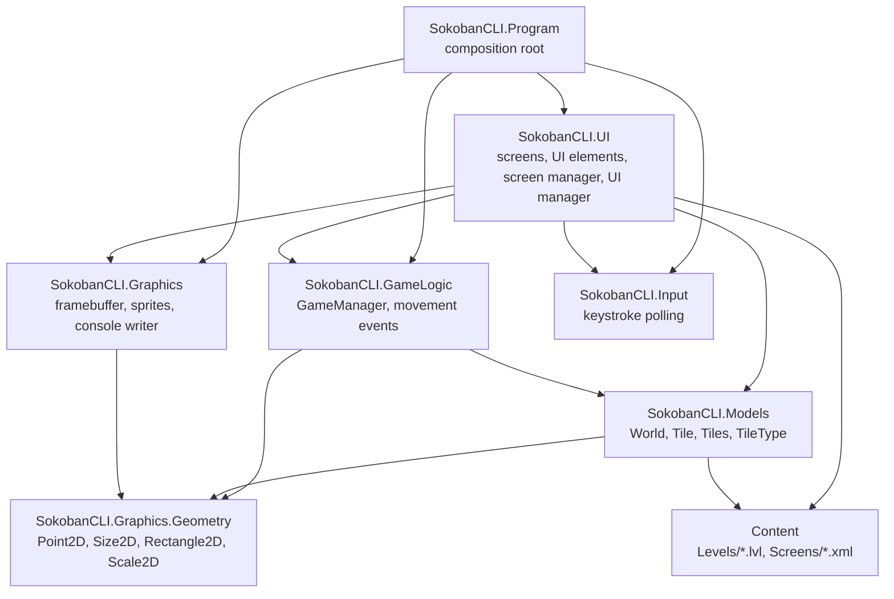

# Architecture

This document complements the root [ARCHITECTURE.md](../ARCHITECTURE.md) rather than restating it. It covers the layer relationships the root document summarises, the composition strategy in detail, the public assembly surface, and the reasoning behind the boundaries that the automated tests enforce. Read the root document first for system context, components, runtime flows, deployment, and extension points.

## Layering in one picture



`SokobanCLI.Graphics.Geometry` is the shared kernel. It is a distinct namespace from `SokobanCLI.Graphics`, and that distinction is load-bearing: `ProductionArchitectureTests` treats `SokobanCLI.Graphics` (exactly) as the rendering boundary and `SokobanCLI\.Graphics.*` as the broader graphics boundary. `Models` is permitted the kernel but forbidden the renderer:

```csharp
private static readonly IObjectProvider<IType> RenderingTypes = Types()
    .That()
    .ResideInNamespace("SokobanCLI.Graphics");
```

Consequence: moving a type from `SokobanCLI.Graphics` into `SokobanCLI.Graphics.Geometry` — or the reverse — silently changes which rules apply to it. A geometry type promoted into the renderer namespace becomes illegal for `Models` to reference and the build fails; a renderer type demoted into the kernel becomes legal for `Models`, which the tests would not report.

## Why namespaces instead of projects

The production assembly is one project, so the C# compiler cannot prevent `Models` from referencing `Graphics`. Two mechanisms substitute for project boundaries:

1. **ArchUnitNET dependency assertions** over the loaded production assembly, one test per boundary (`ProductionArchitectureTests`).
2. **Roslyn syntax and symbol rules** over the production sources, assembled into an in-memory compilation by `ProductionCompilation` so that semantic queries (interface implementation parameter names, `as`-cast preference, mapping-method placement) are possible without referencing the built binary.

The trade-off is recorded in [design-decisions.md](./design-decisions.md): cheap composition and a single build, at the cost of a hand-maintained rule set and slower test runs.

## Composition strategy

There is no dependency-injection container. Composition is split between static singletons and one explicit root.

### Static singletons

| Singleton | Declared in | State it holds for the process lifetime |
|-----------|-------------|-----------------------------------------|
| `GraphicsManager.Instance` | `Graphics/GraphicsManager.cs` | The render `AsciiSpriteBatch` reference and the shadow batch `drawnData` |
| `InputManager.Instance` | `Input/InputManager.cs` | The `KeyboardKeyPressed` subscriber list |
| `ScreenManager.Instance` | `UI/ScreenManager.cs` | The current `Screen` and the `XmlFileObject<Screen>` reader |
| `UiManager.Instance` | `UI/UiManager.cs` | The `UiElements` list |

Each uses the identical double-checked pattern:

```csharp
private static volatile GraphicsManager instance;
private static readonly Lock syncRoot = new();

public static GraphicsManager Instance
{
    get
    {
        if (instance is null)
        {
            lock (syncRoot)
            {
                instance ??= new GraphicsManager();
            }
        }

        return instance;
    }
}
```

`System.Threading.Lock` (a .NET 9+ type) is used instead of `object`; the volatile field plus the lock make first-touch safe, but the application is single-threaded in practice, so the concurrency machinery exists to satisfy the pattern rather than a live requirement. See [concurrency-and-scheduling.md](./concurrency-and-scheduling.md).

Because these are static properties, any type can reach any manager without declaring a dependency. `UiElement` reaches `InputManager` directly in `RegisterEvents`, `Screen` reaches `UiManager` and `InputManager`, and `UiMenuItem`'s subclasses reach `ScreenManager`. This is what makes `Program` small, and also what makes the boundaries unenforceable by signatures: `ProductionArchitectureTests` has to assert the dependency graph after the fact.

### The composition root

`Program` is the only type that both constructs managers and wires cross-boundary behaviour:

```csharp
private static void LoadContent()
{
    spriteBatch = new AsciiSpriteBatch();
    spriteBatch.LoadContent();

    GraphicsManager.Instance.LoadContent();
    GraphicsManager.Instance.SpriteBatch = spriteBatch;

    ScreenManager.Instance.LoadContent();
    InputManager.Instance.KeyboardKeyPressed += (sender, e) => ScreenManager.Instance.Draw(spriteBatch);
}
```

Three ordering constraints are encoded here and nowhere else:

1. `spriteBatch.LoadContent()` must precede `GraphicsManager.Instance.SpriteBatch = spriteBatch`, because the batch sizes itself from `GraphicsManager.Instance.Resolution` and `GraphicsManager.LoadContent` allocates `drawnData` from the same source.
2. `GraphicsManager.Instance.LoadContent()` must precede `ScreenManager.Instance.LoadContent()`, because `ScreenManager.LoadContent` reads resolution and the title screen's elements lay out against it.
3. The `ScreenManager.Instance` singleton is constructed lazily on first access inside `LoadContent`; its constructor immediately constructs a `TitleScreen` and deserialises `Screens/TitleScreen.xml`.

`ProductionArchitectureTests` asserts that exactly one type with full name `SokobanCLI.Program` exists and that no other type depends on it:

```csharp
IArchRule rule = Types()
    .That()
    .AreNot(CompositionRootTypes)
    .Should()
    .NotDependOnAny(CompositionRootTypes)
    .As("only the composition root may drive the application");
```

Also note that `Program` constructs a `GameManager` into a static field that is never used afterwards, while `GameScreen.LoadContent` constructs its own `GameManager`. Two instances exist; only the screen's instance receives input. This matters when reasoning about *which* world is being played — see [components/composition-root.md](./components/composition-root.md) and [ambiguities-and-open-questions.md](./ambiguities-and-open-questions.md).

## Boundary rules in detail

### Models

Permitted: `SokobanCLI.Graphics.Geometry`, `System.IO`, the BCL. Forbidden: `GameLogic`, `Input`, `UI`, and the exact namespace `SokobanCLI.Graphics`.

Enforcement:

```csharp
IArchRule rule = Types()
    .That()
    .Are(ModelTypes)
    .Should()
    .NotDependOnAny(GameLogicTypes)
    .AndShould()
    .NotDependOnAny(InputTypes)
    .AndShould()
    .NotDependOnAny(UiTypes)
    .AndShould()
    .NotDependOnAny(RenderingTypes)
    .As("models must not depend on game logic, input, UI, or rendering");
```

The rule selects by namespace, so any type moved into `SokobanCLI.Models` inherits the restriction.

### GameLogic

Permitted: `Models`, the geometry kernel. Forbidden: `Input`, `UI`.

The boundary is meaningful because `GameManager` deliberately speaks in primitive deltas (`MovePlayer(int deltaX, int deltaY)`) and reports through `PlayerMoved`, so no input or UI type appears in its signature.

### Graphics and Input

Both are leaves. `Graphics` must not reference `Models`, `GameLogic`, `Input`, or `UI`; `Input` must not reference `Models`, `GameLogic`, `Graphics`, or `UI`. `Input` depends on nothing but `System`, which is why key interpretation lives in screens: `InputManager` raises `ConsoleKeyEventArgs` carrying a raw `ConsoleKey` and never maps `W` to a direction.

### UI

The only boundary permitted to depend on all others, and depended upon only by the composition root.

## Cross-boundary mechanisms

Three mechanisms carry behaviour across boundaries without direct type references, and each has a cost:

| Mechanism | Producer | Consumer | Contract | Cost |
|-----------|----------|----------|----------|------|
| `PlayerMoved` event | `GameManager` | `GameScreen`, tests | `(object sender, PlayerMovementEventArgs e)` where `e.PlayerLocation` is the new `Point2D` | An event, not a return value, so callers that ignore it still compile |
| `KeyboardKeyPressed` event | `InputManager` | `Screen` subclasses, every `UiElement` | `(object sender, ConsoleKeyEventArgs e)` | Every screen and every UI element subscribes; `UiElement.OnInputManagerKeyboardKeyPressed` filters on enabled, visible, `CanRaiseEvents`, and `HasInputFocus` |
| Screen name string | `UiMenuLink.LinkId`, `ScreenManager.ChangeScreens` | `ScreenManager.CreateScreen` | A type name resolvable by `Type.GetType($"{typeof(Screen).Namespace}.{screenName}")` | Not compiler-checked; a wrong name produces a null reference |

The `UiElement` filter is worth recording exactly, because it decides whether a key reaches a control:

```csharp
private void OnInputManagerKeyboardKeyPressed(object sender, ConsoleKeyEventArgs e)
{
    if (!IsEnabled || !IsVisible || !CanRaiseEvents || !HasInputFocus)
    {
        return;
    }

    OnKeyPressed(sender, e);
}
```

`UiMenuItem` is the only element overriding `CanRaiseEvents`… it does not; `CanRaiseEvents` defaults to `true` in `UiElement` and is not overridden anywhere in the repository. Menu activation therefore depends entirely on focus, which `MenuScreen.Update` assigns each frame through `UiManager.FocusElement`.

## Public surface

Every manager and UI element type has a public interface (`IGameManager`, `IGraphicsManager`, `IAsciiSpriteBatch`, `IAsciiSprite`, `IInputManager`, `IScreenManager`, `IUiManager`, `IScreen`, `IMenuScreen`, `ITitleScreen`, `IGameScreen`, `IUiElement`, `IUiText`, `IUiMenuItem`, `IUiWorldmap`). `TypeDeclarationConventionTests` asserts that every non-static class with public methods has a corresponding interface and that implementations match interface parameter names.

Two structural facts about the public surface:

- The interfaces are not used for substitution anywhere in production: `Program` and the screens reference the concrete types (`AsciiSpriteBatch`, `UiManager.Instance.UiElements` is `List<UiElement>`), and no production code accepts an interface parameter. Interfaces exist to satisfy the convention rules and, in `GameScreen`/`UiWorldmap`, to pass the game manager as `IGameManager`.
- The assembly exposes no internals. `InternalsVisibleTo` is absent and `ProductionArchitectureTests` reads the assembly attribute list to prove it, while `ProjectReferenceTests` inspects the project file for both `InternalsVisibleTo` and `AssemblyAttribute` forms.

`tester`-visible consequences: unit tests exercise only the public surface, `GameManagerTests` calls `game.World.Tiles[x, y] = Tiles.ById(2)` directly to arrange board states (legal because `Tiles` is a public `Tile[,]` field), and no test can observe private methods such as `GameManager.TryMoveBox` or `UiWorldmap.GetWallShape` except through their effects.

## Dependency direction summary

```
System / BCL
    ↑
Graphics.Geometry (kernel)
    ↑                    ↑
Models               Graphics, Input (leaves)
    ↑                    ↑
GameLogic  ─────────────┘
    ↑
UI
    ↑
Program
```

Content (`Levels`, `Screens`) is input at the edges: `Models` reads level files and `UI` reads screen definitions, both relative to the working directory.

## Related documents

- [design-decisions.md](./design-decisions.md) — why these boundaries were chosen
- [invariants.md](./invariants.md) — what must remain true for the rules to hold
- [change-guide.md](./change-guide.md) — which rule fails when a given kind of change is made