# Game logic

Location: `SokobanCLI/GameLogic/Managers/GameManager.cs`, `SokobanCLI/GameLogic/Managers/IGameManager.cs`, `SokobanCLI/GameLogic/Events/PlayerMovementEventArgs.cs`, `SokobanCLI/GameLogic/Events/PlayerMovementEventHandler.cs`

Type: `SokobanCLI.GameLogic.Managers.GameManager` — `public sealed class : IGameManager`

## Purpose

Own the rules of Sokoban: whether a move is legal, whether a push succeeds, what the board looks like afterwards, how many moves were made, and whether the level is complete. It is the only type that mutates `World` during play.

## Contract

```csharp
public sealed class GameManager : IGameManager
{
    public World World { get; private set; }
    public bool IsRunning { get; private set; }
    public PlayerMovementEventHandler PlayerMoved { get; set; }

    public void Start(int level);
    public void Stop();
    public void MovePlayer(int deltaX, int deltaY);
    public bool GetCompletion();
}
```

| Member | Semantics |
|--------|-----------|
| `World` | The board. Null until `Start` is called |
| `IsRunning` | Gate for `MovePlayer`; set true by `Start`, false by `Stop` |
| `PlayerMoved` | Settable event, not `add`/`remove`-only; assigning replaces all subscribers |
| `Start(int level)` | Replaces `World` with `new World(level)` and sets `IsRunning = true` |
| `Stop()` | Sets `IsRunning = false`; keeps `World` intact |
| `MovePlayer(int, int)` | Attempts a move; see below |
| `GetCompletion()` | Scans the grid for uncovered goals |

`PlayerMoved` being declared as a settable property of delegate type rather than as a field-like `event` is significant: `game.PlayerMoved = delegate { };` in the test setup replaces the subscriber list, and `+=`/`-=` still work because the delegate type supports combination. `IGameManager` declares the same property.

## MovePlayer

```csharp
public void MovePlayer(int deltaX, int deltaY)
{
    if (!IsRunning || deltaX == 0 && deltaY == 0)
    {
        return;
    }

    Point2D playerPosition = World.PlayerPosition;
    Point2D targetPosition = playerPosition + new Point2D(deltaX, deltaY);

    if (!World.Contains(targetPosition))
    {
        return;
    }

    Tile targetTile = World.GetTile(targetPosition.X, targetPosition.Y);
    bool moved = targetTile.Id is 0 or 3;

    if (targetTile.Id is 2 or 5)
    {
        Point2D boxPosition = targetPosition + new Point2D(deltaX, deltaY);
        moved = TryMoveBox(targetPosition, boxPosition, targetTile.Id == 5);
    }

    if (!moved)
    {
        return;
    }

    World.PlayerPosition = targetPosition;
    World.Moves += 1;
    PlayerMoved?.Invoke(this, new PlayerMovementEventArgs(targetPosition));
}
```

Decision order and its consequences:

1. **Guard.** Not running, or a zero delta, returns immediately. `IsRunning` also gates diagonal-free movement after `Stop` is called during completion handling.
2. **Bounds.** `World.Contains` tests `0 <= X < 14` and `0 <= Y < 14`. Out-of-bounds moves are silently rejected.
3. **Walkability by identifier, not by type.** A literal `is 0 or 3` test replaces what `Tile.IsWalkable` expresses (`Type is TileType.Empty or TileType.Goal`). `Tile.IsWalkable` exists and is unit-tested nowhere; `GameManager` never calls it. The two definitions happen to agree today, so any change to one without the other would introduce a rule that only one of them follows.
4. **Push.** Identifiers `2` and `5` route to `TryMoveBox`. Note this branch *overwrites* `moved`; since `moved` was false for identifiers 2 and 5, the assignment is a plain replacement rather than a fallback.
5. **Commit.** Only after success does the player move, the counter increment, and the event fire.

The move counter counts *accepted moves*, not key presses: a blocked move leaves it untouched. There is no undo.

## TryMoveBox

```csharp
private bool TryMoveBox(Point2D targetPosition, Point2D boxPosition, bool targetIsGoal)
{
    if (!World.Contains(boxPosition))
    {
        return false;
    }

    int destinationId = World.GetTile(boxPosition.X, boxPosition.Y).Id;

    if (destinationId is not 0 and not 3)
    {
        return false;
    }

    int boxId = 2;

    if (destinationId == 3)
    {
        boxId = 5;
    }

    int targetId = 0;

    if (targetIsGoal)
    {
        targetId = 3;
    }

    World.Tiles[boxPosition.X, boxPosition.Y] = Tiles.ById(boxId);
    World.Tiles[targetPosition.X, targetPosition.Y] = Tiles.ById(targetId);
    return true;
}
```

| Input | Behaviour |
|-------|-----------|
| `boxPosition` out of bounds | Return false; the player does not move |
| Destination holds anything other than `0` or `3` | Return false; walls and boxes block |
| `targetIsGoal` true | The vacated cell (where the player will stand) is rewritten as `3`, so the goal is preserved |
| `targetIsGoal` false | The vacated cell is rewritten as `0` |

The parameters named `targetPosition` and `boxPosition` are easy to confuse: `targetPosition` is the cell the *player* moves into (currently holding the box), and `boxPosition` is the cell the *box* moves into. Both writes are performed from the `Tiles` factory, so the grid receives shared stateless tile instances.

## GetCompletion

```csharp
public bool GetCompletion()
{
    for (int y = 0; y < World.Size.Height; y += 1)
    {
        for (int x = 0; x < World.Size.Width; x += 1)
        {
            if (World.GetTile(x, y).Id == 3)
            {
                return false;
            }
        }
    }

    return true;
}
```

Semantics: complete when **no cell holds identifier 3**. Implications:

- A box on a goal has identifier `5`, not `3`, so covering a goal with a box removes it from the search.
- The player standing on a goal does *not* change the cell identifier during play, because `World.LoadTiles` converts identifier 6 to `3` at load time and `GameManager` never writes the player into the grid. Standing on the last goal therefore does not complete the level.
- Identifier `4` (the raw player marker) never survives loading, so it cannot affect the result.
- The method is idempotent and has no side effects; `GameScreen.Update` calls it every frame.

Cost is up to 196 tile reads per frame, which is negligible next to console output but does run on every iteration of the unpaced loop.

## Events

```csharp
public delegate void PlayerMovementEventHandler(object sender, PlayerMovementEventArgs e);

public sealed class PlayerMovementEventArgs(Point2D playerLocation)
{
    public Point2D PlayerLocation { get; private set; } = playerLocation;
}
```

`PlayerMovementEventArgs` is a primary-constructor class with a single immutable-in-practice property (public getter, private setter). Its XML documentation reuses the parameter name `playerLocation` with the summary "Key." and the value "The player location.", which is a documentation defect rather than a behavioural one.

## Lifecycle

```mermaid
stateDiagram-v2
    [*] --> Stopped: construction (World null, IsRunning false)
    Stopped --> Running: Start(level) replaces World
    Running --> Running: MovePlayer accepted or rejected; GetCompletion
    Running --> Stopped: Stop()
    Stopped --> Running: Start(level) or Start(World.Level + 1)
```



`Start` is callable at any time, including while running; it discards the current `World` and its move count. `GameScreen` uses that for both `R` (same level) and completion (next level).

## Dependencies and dependants

Depends on `SokobanCLI.Models.World`, `SokobanCLI.Models.Tile` (indirectly, as the element type), `SokobanCLI.Models.Tiles`, `SokobanCLI.Graphics.Geometry.Point2D`, and `SokobanCLI.GameLogic.Events`. It depends on neither `Input` nor `UI`, which `ProductionArchitectureTests` enforces.

Dependants: `GameScreen` (constructs it, subscribes `PlayerMoved`, calls `MovePlayer`, `Start`, `Stop`, `GetCompletion`), `UiWorldmap` (reads `World` through `AssociateGameManager`), `Program` (constructs an unused instance), and `SokobanCLI.UnitTests.GameLogic.Managers.GameManagerTests`.

## Test coverage

`GameManagerTests` (23 tests) covers: start state, stop, zero-delta rejection, wall rejection, empty and goal acceptance, box push onto empty, box push onto goal producing `5`, box blocked by wall, box-on-goal pushed onto empty restoring the goal, box-on-goal pushed onto a goal, event firing with the correct position, and both completion outcomes. Fixtures arrange boards by writing directly into `game.World.Tiles[x, y]` with `Tiles.ById(...)`.

Level 0's layout, from the test comments and the file, is: player at `(7, 5)`, boxes at `(6, 6)` and `(7, 7)`, goals at `(6, 8)` and `(7, 8)`, with the room bordered by walls.

## Related documents

- [models-and-content.md](./models-and-content.md) — `World` and the tile factory
- [flows/player-movement.md](../flows/player-movement.md) — the full key-to-repaint sequence
- [flows/level-advancement.md](../flows/level-advancement.md) — completion handling in the screen