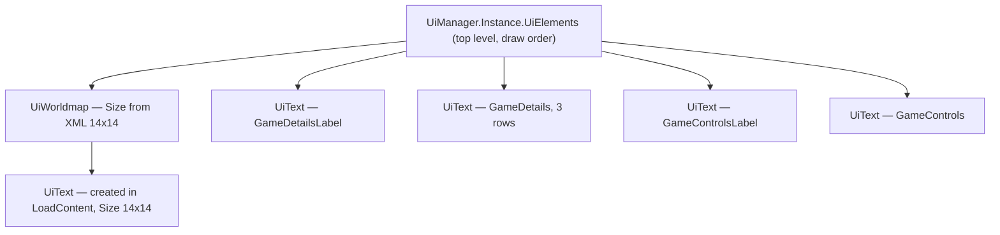

# UI elements

Location: `SokobanCLI/UI/UiManager.cs`, `IUiManager.cs`, `UI/UiElements/` — `UiElement.cs`, `UiText.cs`, `UiMenuItem.cs`, `UiMenuLink.cs`, `UiMenuAction.cs`, `UiWorldmap.cs` and their interfaces

## Purpose

Provide the composable, focusable, disposable pieces the screens assemble: a registry that orders and filters them, a base class that carries layout, state, events, children, and disposal, and five concrete elements.

## UiManager

`public sealed class UiManager : IUiManager` — singleton; the top-level element registry.

| Member | Behaviour |
|--------|-----------|
| `UiElements` | `List<UiElement>` with a public setter; seeded empty in the constructor |
| `LoadContent` | Loads every element (`UiElements.ToList().ForEach(...)`) |
| `UnloadContent` | Unloads every element, then clears the list |
| `Update` | Removes disposed elements, then updates every enabled element |
| `Draw` | Draws every visible element, in list order |
| `FocusElement(string)` | Clears focus on all elements, then sets it on the element with the matching `Id` |
| `FocusElement(UiElement)` | Forwards to the `Id` overload |

```csharp
public void Update(float gameTime)
{
    UiElements.RemoveAll(e => e.IsDisposed);
    UiElements.Where(e => e.IsEnabled).ToList().ForEach(e => e.Update(gameTime));
}
```

Semantics worth noting:

- **Only top-level elements are managed.** `Draw` and `Update` iterate `UiElements`; children are reached recursively by each element's own `Draw`/`Update`. `GameScreen` registers its five elements individually, so they are siblings rather than a hierarchy.
- **List order is draw order and z-order.** `Draw` uses `Where(...).ToList().ForEach(...)`, which preserves order; overlapping elements therefore resolve in favour of later entries.
- **Disposal is swept, not performed, here.** `RemoveAll(e => e.IsDisposed)` removes disposed entries; `UiElement.Dispose` does the actual work. Nothing in production calls `Dispose` on an element, so the sweep is currently inert.
- **`ToList()` on every filter** allocates a list per frame for both `Update` and `Draw`. With five elements this is negligible, but the pattern is intentional: it prevents a collection-modified exception if an element removes itself.
- **`FocusElement` clears focus before setting it**, so calling it with an unknown id leaves every element unfocused. `MenuScreen.Update` relies on this being called every frame.

`UiElements` having a public setter means a caller can replace the registry wholesale, which would orphan previously registered elements (their subscriptions would survive via `UiElement.RegisterEvents`, though nothing does this).

## UiElement

`public class UiElement : IDisposable, IUiElement` — the base of every element. Not sealed, because five types derive from it and two from `UiMenuItem`.

### State

| Member | Default | Notes |
|--------|---------|-------|
| `Id` | `Guid.NewGuid().ToString()` | Identity used by `FocusElement` |
| `Location`, `Size` | `(0, 0)` | `Size` defaults to zero, so an element that is never sized draws nothing |
| `ClientRectangle` | computed | `new Rectangle2D(Location, Size)` |
| `Opacity` | `1.0f` | Clamped to `[0, 1]` by `Math.Max`/`Math.Min` in the setter |
| `BackgroundColour` | `Black` | |
| `ForegroundColour` | `White` | |
| `IsEnabled`, `IsVisible` | both `true` | |
| `IsHovered` | `false`, `[XmlIgnore]` | Never set by any code path |
| `HasInputFocus` | `false`, `[XmlIgnore]` | Set by `UiManager.FocusElement` |
| `Children` | empty `List<UiElement>`, `[XmlIgnore]`, protected setter | |
| `IsDisposed` | `false`, private setter, `[XmlIgnore]` | |
| `CanRaiseEvents` | `true`, protected virtual | Not overridden anywhere |

### Events

`BackgroundColourChanged`, `ForegroundColourChanged`, `LocationChanged`, `SizeChanged`, `Disposed` (all `EventHandler`) and `KeyPressed` (`ConsoleKeyEventHandler`).

Change detection is by cached comparison, not by property setters:

```csharp
protected virtual void RaiseEvents()
{
    if (!CanRaiseEvents)
    {
        return;
    }

    if (oldBackgroundColour != BackgroundColour)
    {
        OnBackgroundColourChanged(this, null);
    }

    if (oldForegroundColour != ForegroundColour)
    {
        OnForegroundColourChanged(this, null);
    }

    if (oldLocation != Location)
    {
        OnLocationChanged(this, null);
    }

    if (oldSize != Size)
    {
        OnSizeChanged(this, null);
    }
}

protected virtual void SetChildrenProperties()
{
    oldBackgroundColour = BackgroundColour;
    oldForegroundColour = ForegroundColour;

    oldLocation = Location;
    oldSize = Size;
}
```

The contract is: `Update` calls `RaiseEvents` (comparing against the cached values) and then `SetChildrenProperties` (writing the cached values back). Any subclass overriding `SetChildrenProperties` must call `base.SetChildrenProperties()` first if it relies on the base comparison, or the cache will be updated without the event firing. `UiText` and `UiMenuItem` both call `base` first, then copy values into their internal sprite or text.

Nothing in production subscribes to any of these events, so the mechanism is currently exercised only by the requirement that subclasses maintain it.

### Lifecycle

```csharp
public virtual void LoadContent()
{
    SetChildrenProperties();

    Children.ForEach(x => x.LoadContent());

    RegisterEvents();

    IsDisposed = false;
}

public virtual void UnloadContent()
{
    UnregisterEvents();

    Children.ForEach(x => x.UnloadContent());
}

public virtual void Update(float gameTime)
{
    Children.RemoveAll(w => w.IsDisposed);

    RaiseEvents();
    SetChildrenProperties();

    Children.Where(e => e.IsEnabled).ToList().ForEach(e => e.Update(gameTime));
}

public virtual void Draw(AsciiSpriteBatch spriteBatch)
    => Children
        .Where(e => e.IsVisible)
        .ToList()
        .ForEach(e => e.Draw(spriteBatch));
```

Base `Draw` draws only children: a concrete element must override `Draw` to render itself. `UiText` overrides it to draw its sprite; `UiWorldmap` overrides it to build text and then call `base.Draw` (which draws its single child `UiText`); `UiMenuItem` does *not* override `Draw`, so it renders through its child `UiText`.

`LoadContent` registers input events for every element. This means every element receives every key event and filters it in `OnInputManagerKeyboardKeyPressed`.

### Disposal

```csharp
public virtual void Dispose()
{
    if (IsDisposed)
    {
        return;
    }

    IsDisposed = true;

    UnloadContent();
    OnDisposed(this, EventArgs.Empty);

    Children.ForEach(child => child.Dispose());

    GC.SuppressFinalize(this);
}
```

Idempotent, unloads, raises, disposes children recursively, and suppresses finalisation. Note that the base class declares `IDisposable` but has no finaliser, and no production code disposes an element.

### Input filtering

```csharp
private void OnInputManagerKeyboardKeyPressed(object sender, ConsoleKeyEventArgs e)
{
    if (!IsEnabled || !IsVisible || !CanRaiseEvents || !HasInputFocus)
    {
        return;
    }

    OnKeyPressed(sender, e);
}
```

Four conditions, all required. `HasInputFocus` is the decisive one for controls; only `MenuScreen.Update` calls `UiManager.FocusElement`, so only menu items ever have focus. A `UiText` therefore never receives a key press even though it subscribes.

### Show and Hide

`Show` sets `IsEnabled` and `IsVisible` to true; `Hide` sets both to false. Nothing in production calls either.

## UiText

`public sealed class UiText : UiElement, IUiText` — a text block rendered through an internal `AsciiSprite`.

| Member | Default | Purpose |
|--------|---------|---------|
| `Text` | `string.Empty` | The text to render |
| `VerticalAlignment`, `HorizontalAlignment` | `Centre`, `Centre` | Alignment inside `Size` |
| `Margins` | `0` | Declared but never read by any code |

```csharp
public override void LoadContent()
{
    text = new AsciiSprite();

    base.LoadContent();
}

public override void Draw(AsciiSpriteBatch spriteBatch)
    => text.Draw(spriteBatch);

protected override void SetChildrenProperties()
{
    base.SetChildrenProperties();

    text.Location = Location;
    text.Size = Size;
    text.Text = Text;
    text.HorizontalAlignment = HorizontalAlignment;
    text.VerticalAlignment = VerticalAlignment;
    text.BackgroundColour = BackgroundColour;
    text.ForegroundColour = ForegroundColour;
}
```

The sprite is refreshed from the element on every property push, which happens from `UiElement.Update` each frame and from `LoadContent`. `Draw` does not call `base.Draw`, so a `UiText` with children would not draw them; none has any.

`Margins` is a public property with a getter and setter that nothing reads: dead configuration surface. It is serialisable from XML, so XML can set it harmlessly.

## UiMenuItem

`public class UiMenuItem : UiElement, IUiMenuItem` — a focusable, activatable menu label.

| Member | Default | Purpose |
|--------|---------|---------|
| `Text` | null | The label |
| `HighlightColour` | `Yellow` | Applied to the text when focused |
| `Activated` | event | Raised on activation |
| `Size` | `(48, 1)` set in the constructor | The menu column width |
| `text` (protected) | a `UiText` child | Rendering |

```csharp
protected override void SetChildrenProperties()
{
    base.SetChildrenProperties();

    text.Text = Text;
    text.Location = Location;
    text.Size = Size;

    if (HasInputFocus)
    {
        text.ForegroundColour = HighlightColour;
    }
    else
    {
        text.ForegroundColour = ForegroundColour;
    }
}
```

The highlight is implemented purely as a foreground colour swap on the child text, which the graphics diff picks up as a changed cell. Because the child's own `ForegroundColour` is set here rather than the parent's, `UiMenuItem.ForegroundColour` is only ever a source value.

```csharp
protected override void OnKeyPressed(object sender, ConsoleKeyEventArgs e)
{
    base.OnKeyPressed(sender, e);

    if (e.Key == ConsoleKey.Enter || e.Key == ConsoleKey.E)
    {
        OnActivated(this, null);
    }
}
```

Activation keys are `Enter` and `E`. There is no `Space` or mouse support.

`UiMenuItem` is not sealed, which permits the two specialisations below. `TypeDeclarationConventionTests` records that classes are sealed unless inheritance is by design, and this is by design.

## UiMenuLink

`public sealed class UiMenuLink : UiMenuItem` — a menu entry that navigates.

| Member | Purpose |
|--------|---------|
| `LinkId` | Target screen name |
| `LinkArgs` | Space-separated arguments for the target screen |

```csharp
protected override void OnActivated(object sender, EventArgs e)
{
    base.OnActivated(sender, e);

    string[] args = [];

    if (!string.IsNullOrWhiteSpace(LinkArgs))
    {
        args = LinkArgs.Split(' ');
    }

    ScreenManager.Instance.ChangeScreens(LinkId, args);
}
```

Arguments are split on a single space, so an argument containing a space cannot be expressed. Whitespace-only `LinkArgs` yields an empty array rather than an array containing an empty string.

## UiMenuAction

`public sealed class UiMenuAction : UiMenuItem` — a menu entry that performs an in-place action.

```csharp
protected override void OnActivated(object sender, EventArgs e)
{
    base.OnActivated(sender, e);

    switch (ActionId)
    {
        case "Exit":
            // TODO: Close the game somehow...
            break;
    }
}
```

`ActionId` is the selector and only `"Exit"` is recognised; its arm is empty, so the entry is inert. Any other `ActionId` falls through with no effect and no diagnostic.

## UiWorldmap

`public sealed class UiWorldmap : UiElement, IUiWorldmap` — renders the board.

| Member | Purpose |
|--------|---------|
| `game` (private) | The manager whose `World` is rendered; needs `AssociateGameManager` before the first draw |
| `text` (private) | A `UiText` child sized `(14, 14)` |

```csharp
public override void LoadContent()
{
    text = new UiText
    {
        Size = new Size2D(14, 14)
    };

    Children.Add(text);

    base.LoadContent();
}
```

The child is sized 14 × 14 from a literal, not from `game.World.Size`; the level format's fixed dimensions make those equal today. The parent's `Size` comes from XML (`14 × 14` in `GameScreen.xml`), and `SetChildrenProperties` (inherited) copies `Location` and `Size`… `UiElement.SetChildrenProperties` only caches; the child's location is never synchronised to the parent by `UiWorldmap`, so the child renders at its own default `(0, 0)`. Because the parent is also at `(0, 0)` from XML, the two agree.

### Draw

```csharp
public override void Draw(AsciiSpriteBatch spriteBatch)
{
    text.Text = string.Empty;

    for (int x = 0; x < game.World.Size.Width; x++)
    {
        for (int y = 0; y < game.World.Size.Height; y++)
        {
            if (x == game.World.PlayerPosition.X && y == game.World.PlayerPosition.Y)
            {
                if (game.World.Tiles[game.World.PlayerPosition.X, game.World.PlayerPosition.Y].Id == 3)
                {
                    text.Text += '☻';
                }
                else
                {
                    text.Text += '☺';
                }
            }
            else
            {
                if (game.World.Tiles[x, y].Id == 1)
                {
                    text.Text += GetWallShape(x, y);
                }
                else
                {
                    text.Text += game.World.Tiles[x, y].Character;
                }
            }
        }

        text.Text += Environment.NewLine;
    }

    base.Draw(spriteBatch);
}
```

Behaviour and consequences:

- The loop nests `x` outside `y` and appends, so each iteration of `x` produces one *line* of text. The rendered line contains the values of `Tiles[x, 0..13]`, i.e. a row of the grid in `y` order. This matches the transposed file layout and is why the level files read as columns.
- The player glyph is chosen by inspecting the cell the player stands on: identifier 3 (a goal) yields `☻`, anything else yields `☺`. The player is never written into the grid, so the underlying tile is intact.
- Walls are rendered through `GetWallShape`; every other tile renders its `Character`.
- Tile `Colour` is never applied. The commented-out `// ConsoleColor.DarkGreen;` and `// game.World.Tiles[x, y].Colour;` lines and the `// Console.ResetColor();` line are the remnants of an intended per-tile colour scheme. The whole map therefore renders in the element's single `ForegroundColour` (default `White`).
- Text is completed with `Environment.NewLine`, then drawn by the base implementation, which draws the child `UiText`.
- `game` is null until `AssociateGameManager` is called. `GameScreen.LoadContent` calls it, so the contract holds in the normal path; a `UiWorldmap` instantiated elsewhere would throw on draw.

### AssociateGameManager

```csharp
public void AssociateGameManager(IGameManager game)
    => this.game = game;
```

The comment above it reads `// TODO: Handle this better`, acknowledging that the world map depends on an injected manager through a setter rather than through its constructor.

### GetWallShape

```csharp
private char GetWallShape(int x, int y)
{
    char c = '?';

    bool n, w, s, e;

    if (x > 0)
    {
        n = game.World.Tiles[x - 1, y].Id == 1;
    }
    else
    {
        n = false;
    }

    if (y > 0)
    {
        w = game.World.Tiles[x, y - 1].Id == 1;
    }
    else
    {
        w = false;
    }

    if (y < Size.Height - 1)
    {
        e = game.World.Tiles[x, y + 1].Id == 1;
    }
    else
    {
        e = false;
    }

    if (x < Size.Width - 1)
    {
        s = game.World.Tiles[x + 1, y].Id == 1;
    }
    else
    {
        s = false;
    }

    // connectivity mask to glyph
}
```

Four neighbour tests, each guarded against the bounds, producing a connectivity mask. The mapping table:

| Mask | Glyph | Mask | Glyph |
|------|-------|------|-------|
| n∧w∧s∧e | `╬` | s∧e | `╔` |
| n∧w∧s | `╣` | s | `║` |
| n∧w∧e | `╩` | e | `═` |
| n∧s∧e | `╠` | n only | `║` |
| n∧w | `╝` | w only | `═` |
| n∧s | `║` | none | `?` (the initialiser) |
| n∧e | `╚` | n∧w∧s∧e handled first | |
| w∧s∧e | `╦` | | |
| w∧s | `╗` | | |
| w∧e | `═` | | |
| w∧s (reached earlier) | — | | |

Because the bounds checks use `Size.Height - 1` for the `y` comparison and `Size.Width - 1` for the `x` comparison, and `Size` here is the *element's* size from XML (14 × 14) rather than `game.World.Size`, the guards are correct only while the two agree. The glyph selection itself is not transposed even though the neighbour semantics are, which is why an apparently vertical wall can render as `═`.

Unmapped masks — for example a wall whose only wall neighbour is to its east when the test that would have caught it is the `n` test — fall through to `?`. In practice isolated or singly-connected walls are rare in the shipped levels, so `?` is not normally visible.

## Element hierarchy in a game screen



Only the world map has a child. `UiText` draws through an internal `AsciiSprite` that is not a child element, and `UiMenuItem` draws through a child `UiText` (not present in the game screen, only in menus).

## Related documents

- [screens.md](./screens.md) — who registers these elements
- [flows/startup-and-rendering.md](../flows/startup-and-rendering.md) — the per-frame update and draw order
- [change-guide.md](../change-guide.md) — adding an element without breaking conventions