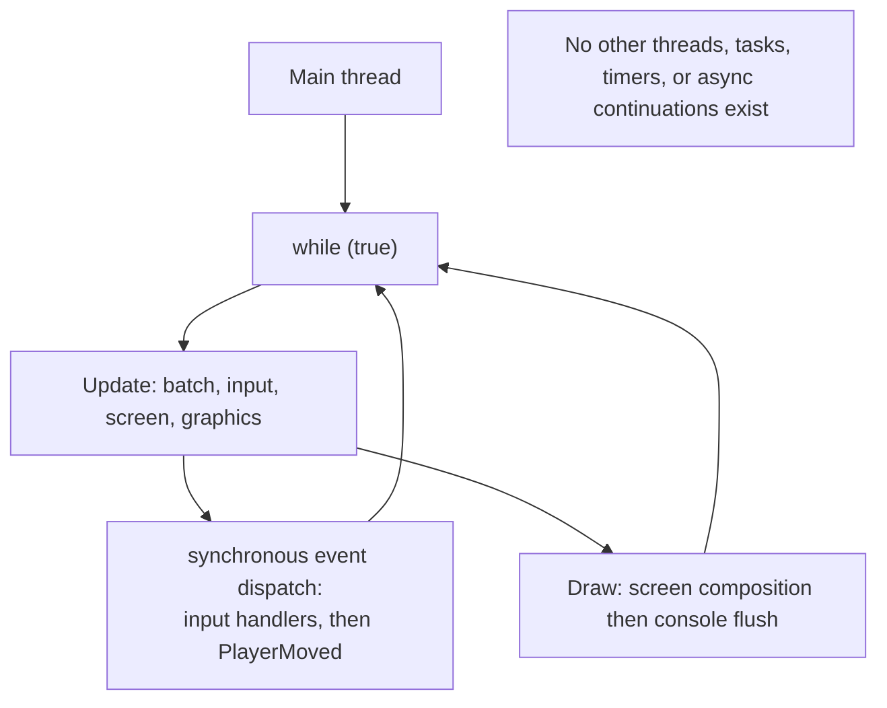

# Concurrency and scheduling

## Summary

SokobanCLI is a single-threaded application. Every observable action — input polling, world mutation, UI update, composition, and console writing — happens on the main thread inside one loop. There is no task, thread, timer, async method, cancellation, or synchronisation primitive in use beyond the singleton initialisation locks.

Concurrency infrastructure exists in exactly four places, all identical in purpose: making lazy singleton creation safe against a hypothetical second thread.

## Threading model



No production type declares `async`, returns a `Task`, uses `Task.Run`, creates a `Thread`, or schedules a `Timer`. `RuleApplicabilityTests` and the convention tests do not need to forbid these because none is present.

## Singleton synchronisation

Four singletons use the same double-checked locking pattern:

```csharp
private static volatile GraphicsManager instance;
private static readonly Lock syncRoot = new();

public static GraphicsManager Instance
{
    get
    {
        if (instance is null)
        {
            lock (syncRoot)
            {
                instance ??= new GraphicsManager();
            }
        }

        return instance;
    }
}
```

| Singleton | Lock field name | Volatile field |
|-----------|-----------------|----------------|
| `GraphicsManager` | `syncRoot` | `instance` |
| `InputManager` | `SyncRoot` | `instance` |
| `ScreenManager` | `SyncRoot` | `instance` |
| `UiManager` | `syncRoot` | `instance` |

Details worth recording:

- `System.Threading.Lock` (a .NET 9+ type) is used rather than `lock (object)`, which `System.Threading` provides as a dedicated mutual-exclusion type. The `lock` statement recognises it.
- The `volatile` qualifier prevents a stale read of the instance field, which is what makes the unlocked first check safe.
- Idiomatically the double check should be `instance ??= new ...()` inside the lock, which is what the code does; the outer `is null` check is the fast path.
- Initialisation is *not* lazy in a meaningful sense for `ScreenManager`: its constructor reads `Screens/TitleScreen.xml`, so first access performs I/O and can throw.
- Field naming is inconsistent across files (`syncRoot` versus `SyncRoot`); `NamingConventionTests` enforces camelCase without an underscore prefix for private fields, and `SyncRoot` in `InputManager` and `ScreenManager` would violate that unless the rule tolerates private static readonly fields with a PascalCase name. The tests pass on the current code, so the rule as implemented permits it.

Because the application is single-threaded, none of these locks is ever contended. They are a convention rather than a requirement; removing them would not change behaviour, and `volatile` alone would suffice.

## Event dispatch is synchronous

All three application events are raised with `?.Invoke(...)` on the calling thread:

| Event | Raised from | Handlers |
|-------|-------------|----------|
| `InputManager.KeyboardKeyPressed` | `InputManager.Update`, inside `Program.Update` | The redraw bridge, the current screen, every live `UiElement` |
| `GameManager.PlayerMoved` | `GameManager.MovePlayer`, inside a key handler | `GameScreen.OnGamePlayerMoved` |
| `UiElement` change events and `Activated` | `UiElement.RaiseEvents`, `UiMenuItem.OnKeyPressed` | None in production |

Consequences that shape behaviour:

- **Screen transitions can happen mid-frame.** `Esc` on the game screen calls `ChangeScreens` from inside a key handler, which runs inside `InputManager.Update`, which runs inside `Program.Update`. The rest of that frame then proceeds against the new screen, including a full console clear and repaint.
- **Re-entrant drawing is possible.** The redraw bridge and `PlayerMoved` both call `Draw`, so a movement key performs two full composition-and-flush passes inside a single update. Nothing guards against this; it is benign because the second pass reflects the newer state.
- **No handler is asynchronous**, so there is no risk of a handler completing after the frame it belongs to.
- **A handler that throws aborts the frame and the process**, because no caller catches anything.

## Scheduling

There is no scheduler. `Program.Main` contains:

```csharp
while (true)
{
    Update();
    Draw();
}
```

| Aspect | Behaviour |
|--------|-----------|
| Pacing | None. The loop spins as fast as the console allows |
| Frame rate | Determined by how quickly the full composition and comparison complete |
| `gameTime` | Increments by exactly 1 per iteration, so it counts frames, not milliseconds |
| Yielding | None. No `Thread.Sleep`, `await`, or `Task.Yield` |
| Cancellation | None. No token, no exit condition, no `break` |
| Termination | Only external interruption or an unhandled exception |

`gameTime` is passed to `ScreenManager.Update`, `GraphicsManager.Update`, `Screen.Update`, and `UiElement.Update`, and every one of those ignores it. No animation, cooldown, or time-based decision exists. Because the counter is a `float` incremented by one per frame, it will lose precision after roughly 16.7 million frames if the process runs long enough, which at maximum speed is a matter of hours; no code depends on it, so the effect is nil.

Practical cost of the missing pacing: the process performs a full world-map text rebuild and a full-screen cell comparison on every iteration. With no input, console *writes* are avoided by the diff, but the compute is not. On a busy terminal this keeps one core occupied. `Ambiguities and open questions` records this as the most likely first optimisation.

## Resource ownership

| Resource | Acquired | Released | Notes |
|----------|----------|----------|-------|
| Console cursor visibility | `Main` sets `CursorVisible = false` | Never; the process restores the terminal on exit only if the runtime does | On abnormal termination the cursor can remain hidden in some terminals |
| `drawnData` and the render batch | `GraphicsManager.LoadContent`, `AsciiSpriteBatch.LoadContent` | `UnloadContent` (never called in production) | Process lifetime |
| Level file handles | `File.ReadAllLines` in `World` | Closed by the method | No stream is held |
| Screen XML reads | `XmlFileObject<Screen>.Read` | Released per call | The reader instance persists |
| Input subscriptions | `UiElement.LoadContent`, `Screen.LoadContent` | `UnloadContent` on screen transition | Elements in a screen that is never unloaded keep their subscriptions |
| `IDisposable` elements | Never disposed in production | `UiElement.Dispose` exists, and `UiManager.Update` sweeps disposed entries, but nothing calls `Dispose` | The sweep is inert |

## Thread-safety of shared state

Were a second thread ever introduced, the following state would be unsafe without new synchronisation:

| State | Why unsafe |
|-------|-----------|
| `AsciiSpriteBatch` arrays | Read by `GraphicsManager.Draw` and written by every element's draw; no lock |
| `World.Tiles` | Written by `GameManager` and read by `UiWorldmap` on the same frame |
| `UiManager.UiElements` | Mutated during screen load/unload and iterated during update/draw |
| `ScreenManager.currentScreen` | Replaced mid-frame by a transition |
| `InputManager.KeyboardKeyPressed` | Subscriber list mutated on load/unload while dispatch may be in progress |

The single-threaded design is the reason none of these is a defect today; it is also the reason the design would not survive concurrent rendering or background level loading without explicit work.

## Related documents

- [flows/startup-and-rendering.md](./flows/startup-and-rendering.md) — the frame pipeline this document explains the scheduling of
- [components/composition-root.md](./components/composition-root.md) — the loop and its `gameTime`
- [ambiguities-and-open-questions.md](./ambiguities-and-open-questions.md) — the unpaced loop and its consequences