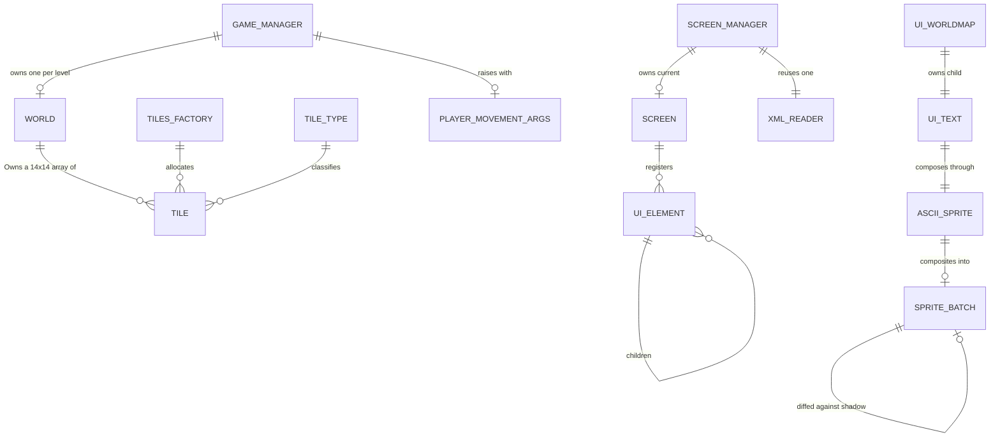

# Data model

## Overview

All application data is in-memory. The only durable artefacts are read-only content files, the build output, and CI/release artefacts. This document lists every field-level entity, its owner, its mutability, and its lifecycle.

## Entity relationship

## `SokobanCLI.Models.World`

| Field | Type | Access | Initial value | Mutated by | Lifecycle |
|-------|------|--------|---------------|------------|-----------|
| `Tiles` | `Tile[,]` (public readonly field) | Read anywhere, cells assigned anywhere | New 14 × 14 array filled by `LoadTiles` | `LoadTiles`, `GameManager.TryMoveBox`, unit tests | Per level; replaced wholesale on `GameManager.Start` |
| `PlayerPosition` | `Point2D` | Public get/set | Set by `LoadTiles` when identifier 4 or 6 is encountered; defaults to `(0, 0)` if the file has no player | `GameManager.MovePlayer` | Per level |
| `Size` | `Size2D` | Public get, private set | `(14, 14)` | Constructor only | Per level, always 14 × 14 |
| `Moves` | `int` | Public get/set | 0 | `GameManager.MovePlayer` increments | Per level |
| `Level` | `int` | Public get, private set | Constructor argument | Constructor only | Per level |

Implicit invariant: `Tiles` is allocated with `Size.Width` × `Size.Height` and indexed `[x, y]` where `0 <= x < 14` and `0 <= y < 14`. `GameManager` never indexes without a preceding `World.Contains` check, and `UiWorldmap` iterates within `Size`.

A level file with no identifier 4 or 6 leaves `PlayerPosition` at `(0, 0)`, which is typically a wall cell; the player would then be drawn on top of it and immediately blocked on most sides. No validation prevents this.

## `SokobanCLI.Models.Tile`

| Field | Type | Access | Set by |
|-------|------|--------|--------|
| `Type` | `TileType` | Public get/set | `Tiles.CreateTile` |
| `Id` | `int` | Public get/set | `Tiles.CreateTile` |
| `Character` | `char` | Public get/set | `Tiles.GetCharacter` |
| `Colour` | `ConsoleColor` | Public get/set | `Tiles.GetColour` |
| `IsWalkable` | `bool` (computed) | Public get | Derived from `Type` |

Mutability: every stored field has a public setter, but no production code writes them after construction. Tiles are effectively immutable value objects created by the factory. `IsWalkable` and `Colour` have no production readers.

## `SokobanCLI.Models.TileType`

`Empty = 0`, `Wall = 1`, `Box = 2`, `Goal = 3`, `Player = 4`, `BoxOnGoal = 5`, `PlayerOnGoal = 6`. Values match the level-file digits exactly, and `Tiles.OfType` relies on that coincidence to derive the identifier from the enumeration value.

## `SokobanCLI.GameLogic.Managers.GameManager`

| Field | Type | Access | Initial value | Mutated by |
|-------|------|--------|---------------|------------|
| `World` | `World` | Public get, private set | null until `Start` | `Start` |
| `IsRunning` | `bool` | Public get, private set | false | `Start`, `Stop` |
| `PlayerMoved` | `PlayerMovementEventHandler` | Public get/set | null | Consumers assigning or combining |

`World` being null before `Start` is a latent hazard: `MovePlayer` checks `IsRunning` first, which is false, so it returns before touching `World`. `GetCompletion` has no such guard and would throw `NullReferenceException` on `World.Size` if called before `Start`. `GameScreen.Update` calls it only after `LoadContent` has started the game.

## `SokobanCLI.GameLogic.Events.PlayerMovementEventArgs`

| Field | Type | Access | Notes |
|-------|------|--------|-------|
| `PlayerLocation` | `Point2D` | Public get, private set | The player's new position after an accepted move |

## `SokobanCLI.Input.Events.ConsoleKeyEventArgs`

| Field | Type | Access | Notes |
|-------|------|--------|-------|
| `Key` | `ConsoleKey` | Public get, private set | The raw key, uninterpreted |

## `SokobanCLI.Graphics.AsciiSpriteBatch`

| Field | Type | Access | Size |
|-------|------|--------|------|
| `Size` | `Size2D` | Public get, private set | Console width × height at load time |
| `CharArray` | `char[,]` | Public get, private set | `[Width, Height]` |
| `BackgroundColourArray` | `ConsoleColor[,]` | Public get, private set | same |
| `ForegroundColourArray` | `ConsoleColor[,]` | Public get, private set | same |
| `ScreenPreview` | `string` | Public get, computed | Rendered on demand |

Initial content after `LoadContent`: space, `Black` background, `White` foreground for every cell.

## `SokobanCLI.Graphics.GraphicsManager`

| Field | Type | Access | Notes |
|-------|------|--------|-------|
| `instance` | `GraphicsManager` | private static volatile | Singleton |
| `drawnData` | `AsciiSpriteBatch` | private | Shadow batch; allocated in `LoadContent` |
| `SpriteBatch` | `AsciiSpriteBatch` | Public get/set | The render batch, supplied by `Program` |
| `Resolution` | `Size2D` | Public get, computed | `new(Console.WindowWidth, Console.WindowHeight)` |

Two independent batches exist by design: the render batch is composed by screens and the shadow batch records what the console displays. Correctness of the diff depends on the two being the same size, which is only guaranteed when the console size does not change between `LoadContent` calls and `SpriteBatch` reallocation.

## `SokobanCLI.Graphics.AsciiSprite`

| Field | Type | Access |
|-------|------|--------|
| `Location` | `Point2D` | Public get/set |
| `Size` | `Size2D` | Public get/set |
| `Text` | `string` | Public get/set |
| `HorizontalAlignment` | `HorizontalAlignment` | Public get/set |
| `VerticalAlignment` | `VerticalAlignment` | Public get/set |
| `BackgroundColour`, `ForegroundColour` | `ConsoleColor` | Public get/set |

`LoadContent` and `UnloadContent` both reset `Text` to empty.

## `SokobanCLI.UI.ScreenManager`

| Field | Type | Access | Notes |
|-------|------|--------|-------|
| `screenReader` | `XmlFileObject<Screen>` | private readonly | Single reused reader; its `Type` is reassigned per transition |
| `currentScreen` | `Screen` | private | The live screen |
| `Size` | `Size2D` | Public get, private set, `[XmlIgnore]` | Refreshed from `GraphicsManager.Resolution` on load and every update |

`XmlFileObject<Screen>` is an external type from `NuciDAL`; from this repository's perspective it is an opaque mutable reader whose `Type` property selects the deserialisation target.

## `SokobanCLI.UI.Screens.Screen`

| Field | Type | Access | Default |
|-------|------|--------|---------|
| `Id` | `string` | Public get/set | A new `Guid` string |
| `XmlPath` | `string` | Public get/set | `Screens/<TypeName>.xml` |
| `Type` | `Type` | Public get/set, `[XmlIgnore]` | `GetType()` |
| `BackgroundColour` | `ConsoleColor` | Public get/set | `Black` |
| `ForegroundColour` | `ConsoleColor` | Public get/set | `White` |
| `HighlightColour` | `ConsoleColor` | Public get/set | `Yellow` |
| `ScreenArgs` | `string[]` | Public get/set | null for a directly constructed screen; assigned by the manager |

## `SokobanCLI.UI.Screens.MenuScreen`

| Field | Type | Access | Default |
|-------|------|--------|---------|
| `Axis` | `string` | Public get/set | `"Y"` |
| `Spacing` | `int` | Public get/set | `1` |
| `Links` | `List<UiMenuLink>` | Public get/set, `[XmlElement("Link")]` | empty |
| `Actions` | `List<UiMenuAction>` | Public get/set, `[XmlElement("Action")]` | empty |
| `Items` | `List<UiMenuItem>` | Public get, computed, `[XmlIgnore]` | links then actions |
| `ItemNumber` | `int` | Public get, private set, `[XmlIgnore]` | `0` |

## `SokobanCLI.UI.UiElements.UiElement`

| Field | Type | Access | Default | XML |
|-------|------|--------|---------|-----|
| `Id` | `string` | Public get/set | new `Guid` string | serialisable |
| `Location` | `Point2D` | Public get/set | `(0, 0)` | serialisable |
| `Size` | `Size2D` | Public get/set | `(0, 0)` | serialisable |
| `ClientRectangle` | `Rectangle2D` | Public get, computed | from location and size | ignored implicitly |
| `Opacity` | `float` | Public get/set, clamped | `1.0f` | serialisable |
| `BackgroundColour`, `ForegroundColour` | `ConsoleColor` | Public get/set | `Black`, `White` | serialisable |
| `IsEnabled`, `IsVisible` | `bool` | Public get/set | `true` | serialisable |
| `IsHovered` | `bool` | Public get/set | `false` | `[XmlIgnore]` |
| `HasInputFocus` | `bool` | Public get/set | `false` | `[XmlIgnore]` |
| `Children` | `List<UiElement>` | Public get, protected set | empty | `[XmlIgnore]` |
| `IsDisposed` | `bool` | Public get, private set | `false` | `[XmlIgnore]` |
| `CanRaiseEvents` | `bool` | protected virtual get | `true` | not present on the interface |
| `oldBackgroundColour`, `oldForegroundColour`, `oldLocation`, `oldSize` | cached values | private | set by `SetChildrenProperties` | n/a |

The four cached fields are the change-detection state backing the element's change events.

## Content files

| File pattern | Structure | Read by | Written by |
|--------------|-----------|---------|-----------|
| `Levels/<n>.lvl` | 14 lines × 14 digits, digits 0–6, transposed so line index is the grid X | `World` constructor via `File.ReadAllLines` | Nothing in the application |
| `Screens/<TypeName>.xml` | One root element named after the screen type, children matching screen and element property names | `XmlFileObject<Screen>` via `ScreenManager` | Nothing in the application |
| `Screens/ScreenManager.xml` | Empty `<ScreenManager>` root | Nothing | n/a |

## State ownership summary

| State | Sole writer | Readers |
|-------|-------------|---------|
| `World.Tiles` cells | `GameManager` (during play), `World` (during load), tests | `GameManager`, `UiWorldmap`, `World.GetTile` |
| `World.PlayerPosition` | `World` (load), `GameManager` (move) | `GameManager`, `UiWorldmap` |
| `World.Moves` | `GameManager` | `GameScreen` (details text) |
| `GameManager.IsRunning` | `GameManager` | `GameManager.MovePlayer` |
| Render batch contents | `UiText.Draw`, `UiWorldmap.Draw` → `AsciiSpriteBatch.Draw` | `GraphicsManager.Draw` |
| `drawnData` | `GraphicsManager.Draw` and `Clear` | `GraphicsManager.Draw` |
| `UiManager.UiElements` | `Screen`/`MenuScreen`/`GameScreen` `LoadContent`, `UiManager.UnloadContent`, `UiManager.Update` sweep | `UiManager` |
| `MenuScreen.ItemNumber` | `MenuScreen.OnKeyPressed` writes, `Update` clamps | `MenuScreen` |
| `HasInputFocus` | `UiManager.FocusElement` | `UiElement` input filter, `UiMenuItem` highlight |

## Related documents

- [invariants.md](./invariants.md) — the conditions these fields must maintain
- [state-and-persistence.md](./state-and-persistence.md) — lifetimes and the absent persistence
- [components/models-and-content.md](./components/models-and-content.md) — `World` behaviour in detail