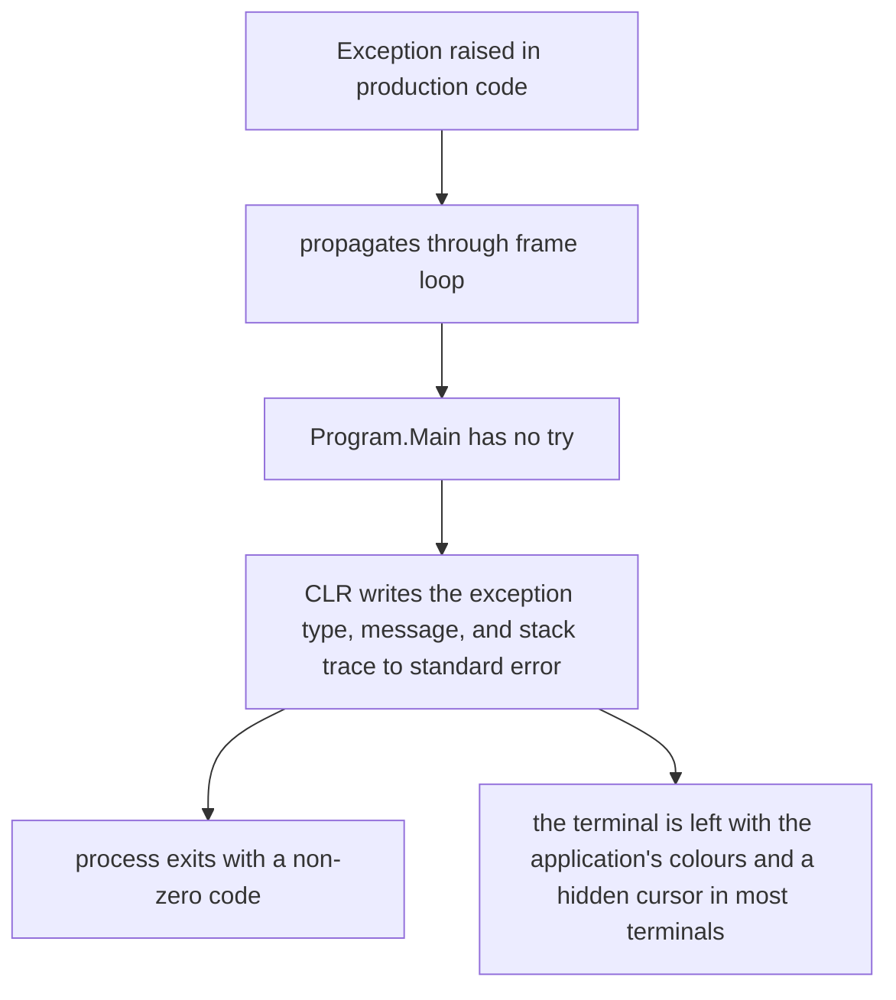

# Error handling

## Summary

There is no error handling in the production code. Across all production source files there is exactly one `throw` statement pair (both in `World.ValidateRows`), zero `try` statements, zero `catch` clauses, and zero `finally` blocks. Every recoverable situation is expressed as a silent early return; every unrecoverable one terminates the process with a stack trace on standard error.

## The two mechanisms

| Mechanism | Where used | Meaning |
|-----------|-----------|---------|
| Silent guard | Move validation in `GameManager`, input polling in `InputManager`, alignment branches in `MenuScreen`, XML-existence check in `ScreenManager` | The situation is expected and requires no action |
| Unhandled exception | Everything else | The situation is unexpected; the process dies |

Both are deliberate in the sense that the code was written this way, but only the first is a designed error strategy.

## Silent guards, in full

| Guard | Location | Condition | Effect |
|-------|----------|-----------|--------|
| Not running or zero delta | `GameManager.MovePlayer` | `!IsRunning \|\| deltaX == 0 && deltaY == 0` | Move ignored |
| Out of bounds | `GameManager.MovePlayer` | `!World.Contains(targetPosition)` | Move ignored |
| Non-walkable target | `GameManager.MovePlayer` | target identifier is neither 0, 3, 2, nor 5 | Move ignored |
| Box destination blocked | `GameManager.TryMoveBox` | destination out of bounds or identifier not 0 or 3 | Push refused, move ignored |
| No key buffered | `InputManager.Update` | `!Console.KeyAvailable` | Return without reading |
| Element cannot take input | `UiElement.OnInputManagerKeyboardKeyPressed` | disabled, invisible, `!CanRaiseEvents`, or no focus | Key ignored |
| Unknown axis | `MenuScreen.AlignMenuItems`, `OnKeyPressed` | `Axis` is neither `X`/`x` nor `Y`/`y` | Items stay at their current location; navigation does nothing |
| Index not yet clamped | `MenuScreen.Update` | `ItemNumber < 0` or beyond the last item | Clamped to a valid index |
| Already disposed | `UiElement.Dispose` | `IsDisposed` | No-op, making disposal idempotent |
| No XML file | `ScreenManager.CreateScreen` | `!File.Exists(screen.XmlPath)` | Constructed screen defaults are used |
| No screen arguments | `GameScreen.LoadContent` | `ScreenArgs` null or empty | Level 0 is used |
| No link arguments | `UiMenuLink.OnActivated` | `LinkArgs` null, empty, or whitespace | Empty argument array |
| No player position found | `World.LoadTiles` | No identifier 4 or 6 in the file | `PlayerPosition` stays `(0, 0)` — not a guard, an omission |

The move guards are the only ones with correctness significance: they are what make a rejected move side-effect-free, which [invariants.md](./invariants.md) records as INV-9.

## The only thrown exceptions

```csharp
private static void ValidateRows(string[] rows, string levelPath)
{
    if (rows.Length != DefaultSize)
    {
        throw new InvalidDataException($"Level '{levelPath}' must contain {DefaultSize} rows.");
    }

    foreach (string row in rows)
    {
        if (row.Length != DefaultSize)
        {
            throw new InvalidDataException($"Level '{levelPath}' rows must contain {DefaultSize} tiles.");
        }
    }
}
```

Both messages name the offending file path, which makes them diagnosable from the stack trace alone. They are the only exceptions the application raises deliberately, and neither is caught.

## Exception surfaces by component

| Component | Exception | Trigger | Reachable from |
|-----------|-----------|---------|----------------|
| `World` | `FileNotFoundException` (from `File.ReadAllLines`) | Level file absent | Startup, `R`, completion advancement |
| `World` | `DirectoryNotFoundException` | `Levels/` absent | Startup, `R`, completion advancement |
| `World` | `InvalidDataException` | Row count or row length not 14 | Any level load |
| `World` | `IndexOutOfRangeException` (from `rows[x][y]`) | Unreachable given validation, since lengths are checked first | n/a |
| `GameManager` | `NullReferenceException` (from `World.Size` in `GetCompletion`) | `GetCompletion` called before `Start` | Only if a caller violates the lifecycle |
| `GraphicsManager` | `IndexOutOfRangeException` | Shadow and render batch sizes differ after a terminal resize | Frame loop, screen transition |
| `AsciiSpriteBatch` | `ArgumentException` (from `Console.SetCursorPosition`) | Console dimensions smaller than the framebuffer, on terminals that report zero size | `GraphicsManager.Draw` |
| `ScreenManager` | `DirectoryNotFoundException`, `IOException`, `XmlException`, `InvalidOperationException` | Title screen XML absent or malformed, or deserialiser state invalid | Startup, screen transition |
| `ScreenManager` | `ArgumentNullException` (from `Activator.CreateInstance(null)`) | `screenName` resolves to no type | Menu link activation |
| `ScreenManager` | `NullReferenceException` | `screenName` resolves to a type outside `SokobanCLI.UI.Screens`, so the `as Screen` cast yields null | Menu link activation |
| `MenuScreen` | `ArgumentOutOfRangeException` (from `Items[index]`) | A menu screen with no links and no actions | Frame loop on that screen |
| `GameScreen` | `FormatException` (from `int.Parse`) | Non-numeric `ScreenArgs[0]` | Screen activation with numeric link arguments |
| `UiWorldmap` | `NullReferenceException` | `Draw` before `AssociateGameManager` | Only if a world map is used outside a game screen |
| `Program` | `IOException` | `Console.CursorVisible` set on a redirected console | Startup |
| All | `Exception` | Anything unanticipated | Anywhere |

Every one of these propagates out of `Program.Main` because nothing in the call chain catches.

## Termination behaviour



Observable consequences of unhandled termination:

- The **display is left as it was**, often with non-default console colours, because `GraphicsManager.Draw` sets `Console.BackgroundColor` and `Console.ForegroundColor` per cell and never restores them.
- The **cursor remains hidden** in terminals that honour `Console.CursorVisible` per-process-wide rather than per-console-handle, because `Main` hides it and nothing restores it.
- The **stack trace is the only diagnostic**, and it appears on the console the game has been using, which may render it in an unexpected colour.

## Failure classification

| Class | Examples | Current response | Better response implied by the design |
|-------|----------|------------------|---------------------------------------|
| Expected, benign | Blocked move, no key, disabled element | Silent guard (correct) | None needed |
| Expected, user-visible | Invalid `ScreenArgs`, unknown `LinkId`, empty menu | Unhandled exception | Validate at screen load and fall back to the title screen |
| Environment | Missing working directory, unresolvable screen XML | Unhandled exception | Report that content must sit beside the executable and exit cleanly |
| Content authoring | Malformed level dimensions | `InvalidDataException` with the path | Adequate; could additionally validate digit range |
| Design limit | Advancing past the last level | `FileNotFoundException` from `Levels/21.lvl` | Detect the last level and stop or loop |
| Rendering environment | Terminal resized mid-run | `IndexOutOfRangeException` | Reallocate both batches together and clamp to the smaller size |

## Asymmetries worth noting

- **Level content is validated; screen content is not.** `World.ValidateRows` checks dimensions, while `ScreenManager` deserialises XML with no schema check and tolerates a missing file, so a malformed screen file fails harder than a malformed level file (which at least produces a readable message).
- **The level file path is checked only by the file system.** A level with 14 × 14 non-digit characters loads without complaint and produces an empty board, so the most likely content error — a typo introducing a letter — is the one error class that passes silently.
- **`GetCompletion` is unguarded while `MovePlayer` is guarded.** The lifecycle mismatch is tolerated only because `GameScreen.LoadContent` always starts the game before the first `Update`.
- **`ScreenManager.CreateScreen` uses the null-forgiving operator on a value that genuinely can be null.** `Type.GetType(...)!` suppresses the compiler warning that would otherwise point at the defect.
- **`UiMenuItem.OnActivated` fires with a null `EventArgs`** in the activation path (`OnActivated(this, null)`), so any handler dereferencing `e` would throw. No production handler dereferences it.

## Testing implications

No test asserts any exception behaviour. `GameManagerTests` covers only successful and silently-rejected moves; there is no test for `World` validation failures, no test for `ScreenManager` resolution failures, and no test for the framebuffer size mismatch. A contributor adding exception handling has no regression baseline other than manual reproduction, and would need to add tests for each path — with the complication that most of these paths sit behind `Console` or the file system and therefore need seams that do not currently exist.

## Related documents

- [troubleshooting.md](./troubleshooting.md) — the observable symptoms and their mitigations
- [invariants.md](./invariants.md) — the conditions whose violation produces these failures
- [change-guide.md](./change-guide.md) — where to add handling without breaking conventions