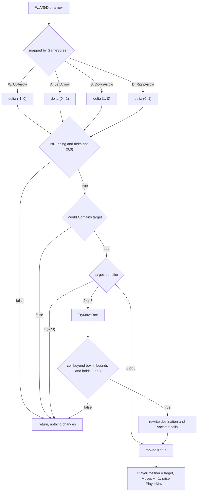

# Player movement

## Intent

Trace a single movement key from the console device to the changed cells on screen, including box pushing and the exact points where a move is rejected.

## Sequence

```mermaid
sequenceDiagram
    participant Console as Console device
    participant Input as InputManager
    participant Bridge as Program redraw bridge
    participant Element as UiElement handlers
    participant Screen as GameScreen
    participant Game as GameManager
    participant World as World
    participant Map as UiWorldmap
    participant Graphics as GraphicsManager

    Console->>Input: key buffered
    Input->>Input: Console.KeyAvailable true
    Input->>Input: Console.ReadKey(true)
    Input->>Bridge: KeyboardKeyPressed (subscribed before GameScreen existed)
    Bridge->>Map: draw current screen into the render batch
    Map->>World: read tiles and player position
    Bridge->>Graphics: Draw() - flush pre-move frame
    Input->>Element: KeyboardKeyPressed
    Note over Element: every element filters on enabled, visible, CanRaiseEvents, HasInputFocus; UiText never passes
    Input->>Screen: KeyboardKeyPressed
    Screen->>Game: MovePlayer(deltaX, deltaY)
    Game->>World: Contains, GetTile, then mutate Tiles and PlayerPosition, increment Moves
    Game->>Screen: PlayerMoved
    Screen->>Map: draw current screen into the render batch
    Screen->>Graphics: Draw() - flush post-move frame
    Input-->>Console: return from Update
    Note over Graphics: the frame loop continues with its own Update and Draw
```

The ordering is decided by subscription order on `InputManager.KeyboardKeyPressed`:

| Order | Subscriber | When subscribed |
|-------|-----------|-----------------|
| 1 | `Program`'s redraw bridge | `Program.LoadContent`, before any game screen exists |
| 2 | The current screen's `OnKeyPressed` | On the screen's `LoadContent` |
| 3 | Every live `UiElement`'s filter | On each element's `LoadContent` |

For the game screen this yields: bridge (pre-move paint), elements (all filtered out), screen (the move). The `PlayerMoved` handler then paints again. A movement key therefore produces two flushes, the first redundant.

## Move decision path



## State transitions during an accepted push

Starting from a box on an empty cell pushed onto a goal:

| Cell | Before | After |
|------|--------|-------|
| Player origin | player position | empty (the grid holds no player marker; only `PlayerPosition` changed) |
| Target (where the box was) | `2` (box) | `0` (empty) or `3` (goal, when the box was already on a goal) |
| Beyond the box | `0` (empty) or `3` (goal) | `2` (box) or `5` (box on goal) |
| `World.PlayerPosition` | origin | target |
| `World.Moves` | n | n + 1 |

The player's origin cell is not written at all. Because the player is a position rather than a tile, nothing in `Tiles` records where the player *was*; the renderer decides cell content from the identifier alone plus, for the single player cell, a comparison against `PlayerPosition`. This is what allows the player to walk over a goal without consuming it.

## Rejection audit

| Rejection | Condition | Cells touched | Moves incremented | Event raised |
|-----------|-----------|---------------|-------------------|--------------|
| Manager stopped | `!IsRunning` | none | no | no |
| Zero delta | both deltas zero | none | no | no |
| Out of bounds | target outside 0..13 in either axis | none | no | no |
| Wall | target identifier 1 | none | no | no |
| Box blocked by wall | cell beyond box holds 1 | none | no | no |
| Box blocked by box | cell beyond box holds 2 or 5 | none | no | no |
| Box pushed out of bounds | cell beyond box outside the grid | none | no | no |

Every rejection returns before any write, so the board is never left partially updated. `TryMoveBox` computes its decision and its writes in one pass with no intermediate mutation: both grid writes happen only after all checks succeed, so a partial push cannot occur even if the second write were to throw.

## Effects visible to the player

| Effect | Source |
|--------|--------|
| Player glyph moves | `UiWorldmap.Draw` places `☺` or `☻` at `PlayerPosition` |
| Box glyph moves | Rewritten `Tiles` cell renders `O` or `@` |
| Vacated cell shows floor or goal | Rewritten `Tiles` cell renders space or `+` |
| Wall glyphs around changed cells may change | `GetWallShape` recomputes from neighbours for every wall drawn |
| Move counter increases | `GameDetails.Text` rebuilt in `GameScreen.SetChildrenProperties` each update |
| Player coordinates text changes | Same assignment |
| Console cells rewritten | `GraphicsManager.Draw` compares each cell against the shadow batch |

Note that wall glyphs are recomputed for every wall on every draw, so a box appearing next to a wall does not change that wall's glyph. Wall shape depends only on whether neighbours are walls, and pushing a box never changes a wall.

## Performance characteristics

- A move costs one full screen composition plus two full-batch comparisons (pre-move flush from the bridge, post-move flush from `PlayerMoved`) in addition to the frame loop's own draw.
- The move counter and coordinate text are not cached; text is rebuilt every frame regardless of movement, so a fast typist's cost is barely different from an idle cost apart from the extra flush.
- There is no input queue limit: buffered keys are consumed one per frame, and frames are as fast as the console permits, so a burst of keys drains quickly.

## Related documents

- [components/game-logic.md](../components/game-logic.md) — the rules implementation
- [behaviour/play-a-level.md](../behaviour/play-a-level.md) — the player-facing view
- [flows/level-advancement.md](./level-advancement.md) — what happens once the last goal is covered