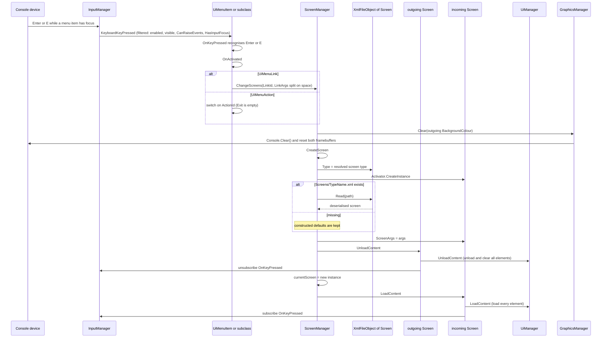
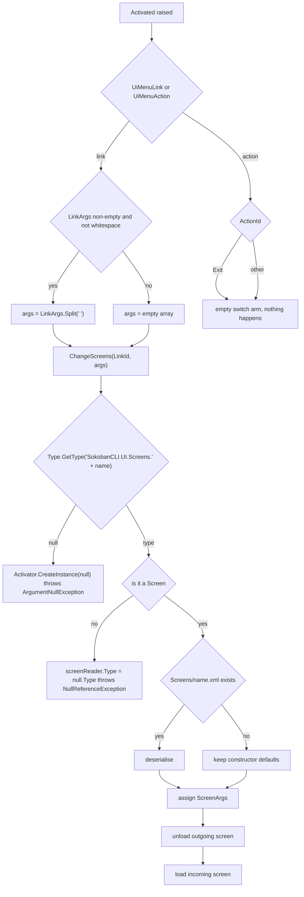

# Screen navigation

## Intent

Trace an activated menu entry through to a loaded replacement screen, including reflection, XML deserialisation, and console clearing.

## Sequence

## Decision points

## What each stage guarantees

| Stage | Guarantee after it completes |
|-------|------------------------------|
| `GraphicsManager.Clear` | Console blanked in the outgoing background colour; shadow batch matches the console; render batch reset to black/white/space so the next flush repaints |
| `CreateScreen` | A `Screen` instance exists with `ScreenArgs` assigned and, if the XML exists, its declared properties applied |
| `Old.UnloadContent` | The outgoing screen's key handler is unsubscribed and `UiManager.UiElements` is empty |
| `currentScreen = newScreen` | Exactly one screen is referenced by the manager |
| `New.LoadContent` | The new screen's elements are registered and loaded, its key handler is subscribed, and any menu alignment has run |

## Interleaving with the frame loop

`ChangeScreens` is invoked from a key handler, which is invoked from `InputManager.Update`, which is invoked from `Program.Update`. The current frame therefore continues after the transition with:

- `ScreenManager.Instance.Update(gameTime)` operating on the *new* screen,
- `GraphicsManager.Instance.Update(gameTime)` (empty),
- `ScreenManager.Instance.Draw` composing the new screen into the render batch,
- `GraphicsManager.Instance.Draw` flushing the whole visible area, because `Clear` desynchronised the batches.

The new screen's first visible frame is therefore the frame in which the transition occurred; there is no blank intermediate frame.

When the transition originates from `Esc` inside `GameScreen.OnKeyPressed`, the screen that is unsubscribing its handler is the same screen whose handler is currently executing. This is safe because the event invocation captured its delegate list before dispatching; the unsubscription affects subsequent keys.

## Re-entrancy risks

| Risk | Mechanism | Observable effect |
|------|-----------|-------------------|
| Transition during element update | A key arrives while `UiManager.Update` is iterating; the handler changes the screen, which clears `UiElements` mid-iteration | `UiManager.Update` uses `ToList()` for the iteration after `RemoveAll`, so clearing the underlying list mid-iteration does not throw, but elements after the sweep may update and then be discarded |
| Shared XML reader state | `screenReader.Type` is reassigned per transition; a nested transition (a screen loading another screen) would leave the reader pointed at the inner screen | Only reachable if a `LoadContent` performs a transition, which none does |
| Double transition | Two keys processed in consecutive frames while a menu is activating | The second transition runs on the already-replaced screen; harmless but wastes work |

## Postconditions

- `currentScreen` is a new instance; the previous instance is unreferenced except by any delegate that captured it.
- `UiManager.UiElements` contains the new screen's top-level elements only.
- The console shows the new screen's first frame, fully repainted.
- Level progress in an abandoned `GameScreen` is gone: the `GameManager` and `World` were owned by that screen instance.

## Related documents

- [behaviour/navigate-screens.md](../behaviour/navigate-screens.md) — the player-facing description and key table
- [components/screens.md](../components/screens.md) — `ScreenManager`, `Screen`, `MenuScreen` implementation detail
- [flows/level-advancement.md](./level-advancement.md) — the automatic *internal* progression that does not use this path