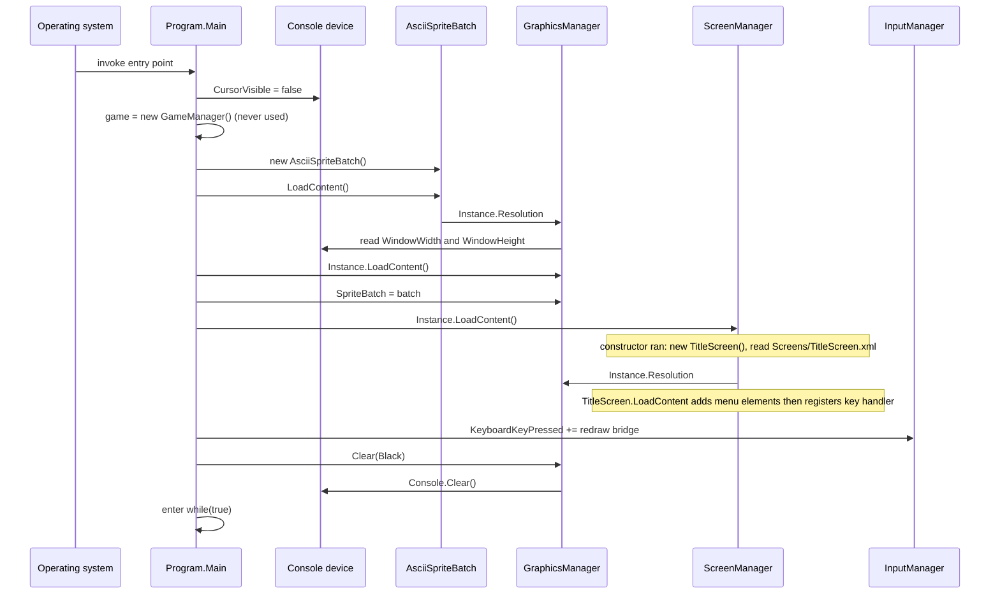
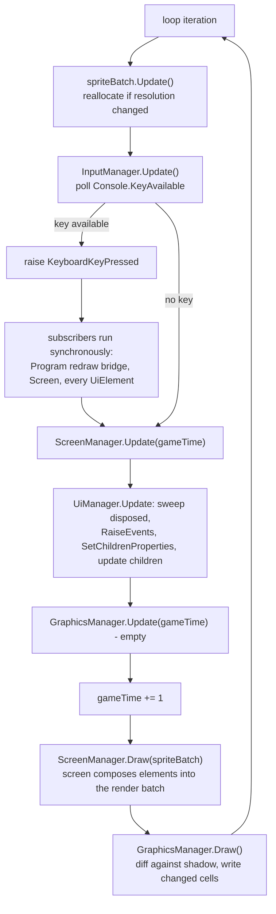

# Startup and rendering

## Intent

Describe what happens between process launch and the first visible frame, and what happens on every subsequent frame. This is the flow to trace when nothing appears, when the display is stale, or when startup fails.

## Startup sequence

Step detail with the state each step establishes:

| Step | State established | Failure mode |
|------|-------------------|--------------|
| `Console.CursorVisible = false` | Cursor hidden | Throws on a redirected console (`IOException`) |
| `new GameManager()` | An unused manager instance in a static field | None |
| `new AsciiSpriteBatch()` | An empty batch object | None |
| `batch.LoadContent()` | `CharArray`/colour arrays sized to the current console | Throws if `Console.WindowWidth` is 0 (some redirected terminals) |
| `GraphicsManager.Instance.LoadContent()` | `drawnData` allocated at the same size | None distinct |
| `GraphicsManager.Instance.SpriteBatch = batch` | The render batch is discoverable by `GameScreen.OnGamePlayerMoved` | None |
| `ScreenManager.Instance.LoadContent()` | Singleton constructed, `TitleScreen` deserialised, `Size` set, elements loaded, key handler registered | `DirectoryNotFoundException` or `XmlException` if `Screens/TitleScreen.xml` is missing or malformed |
| `InputManager.Instance.KeyboardKeyPressed += …` | The redraw bridge | None |
| `GraphicsManager.Instance.Clear(Black)` | Console blanked; shadow batch records black; render batch reset to black/white/space | Throws `IndexOutOfRangeException` if the shadow batch is smaller than the render batch |
| `while (true)` | Frame loop begins | None; never exits |

The first frame therefore renders with an empty render batch (all spaces with black background and white foreground — the state `Clear` left it in) and an empty screen if the deserialisation produced no elements. The first thing written to the console is not blanking but the first frame's changed cells, which after `Clear` is every cell of the visible area because `Clear` deliberately desynchronises the two batches.

## Frame loop

### Update ordering and why it matters

1. **`spriteBatch.Update()`** — If `GraphicsManager.Instance.Resolution != spriteBatch.Size`, the batch is reallocated and reset. This must happen before anything composes into the batch, because the old arrays are discarded.
2. **`InputManager.Instance.Update()`** — At most one key is read and dispatched synchronously. Because dispatch is synchronous, the rest of the frame (screen update, draw) runs after the handlers. Handlers can, however, perform a screen transition, which calls `Console.Clear()` and rewrites both batches in the middle of the update phase. After such a transition the remaining statements of this frame still execute against the *new* screen.
3. **`ScreenManager.Instance.Update(gameTime)`** — Refreshes `Size` from the console, then updates the current screen. For a `MenuScreen` that means clamping and assigning focus before elements update; for `GameScreen` it means updating elements, re-running layout, and checking completion — which can replace the `World`.
4. **`GraphicsManager.Instance.Update(gameTime)`** — empty.
5. **`gameTime += 1`** — a frame counter, not a clock. No production code makes decisions from it; it is passed to `Update(float)` implementations, all of which ignore it.

### Draw ordering

1. **`ScreenManager.Instance.Draw(spriteBatch)`** — delegates to the current screen. `Screen.Draw` calls `UiManager.Draw`, which iterates visible top-level elements in list order. `UiText` copies its properties into an `AsciiSprite` only in `SetChildrenProperties`, which ran during update, so draw uses the values computed in this frame's update. `UiWorldmap.Draw` additionally rebuilds its text in place.
2. **`GraphicsManager.Draw()`** — walks the render batch, compares each cell against `drawnData`, writes differences with explicit cursor positioning and colours, updates `drawnData`, and finally moves the cursor to (0, 0).

### Cost profile per frame

| Operation | Cost when nothing changed | Cost when a cell changed |
|-----------|---------------------------|--------------------------|
| `spriteBatch.Update` | one `Resolution` read (two console property reads) | reallocation of three arrays |
| `InputManager.Update` | one `Console.KeyAvailable` | one `Console.ReadKey` plus all subscribers |
| `ScreenManager.Update` | screen update plus element updates | same |
| Screen draw | full text composition of the world map: 196 tile reads, 14 string appends, plus one `Split` per `UiText` during sprite compositing | same |
| `GraphicsManager.Draw` | 196×`W`×`H` comparisons | per changed cell: one `SetCursorPosition`, two colour assignments, one `Console.Write` |

The dominant fixed cost is the world map rebuild plus the full-batch comparison, both of which happen on every iteration of an unpaced loop. Even with no visible change, the process continually reads 196 tiles, composes text, performs a full-screen comparison, then repeats. The console write is avoided, which is the expensive part; the composition is not.

### When the display is fully repainted

- On the frame after `GraphicsManager.Clear` (because `Clear` resets the render batch to black/white/space).
- On the frame after any screen transition (because `ChangeScreens` calls `Clear`).
- On every frame where the console was cleared externally, since the shadow batch still believes the old content is present and the render batch matches the old content, so nothing would be written. External clearing therefore produces a stale-looking display until something changes.

## Failure points in the loop

| Failure | Where | Observable result |
|---------|-------|-------------------|
| Level file missing | `World` constructor, reached from `Start` | `FileNotFoundException` propagates out of `Program.Main`, process exits with a stack trace |
| Level file malformed | `World.ValidateRows` | `InvalidDataException` with the file path in the message |
| UUID screen name | `ScreenManager.CreateScreen` | `ArgumentNullException` from `Activator.CreateInstance(null)` |
| Screen XML malformed | `XmlFileObject<Screen>.Read` | `XmlException` |
| Terminal enlarged mid-run | `GraphicsManager.Draw` or `Clear` | `IndexOutOfRangeException`; see [troubleshooting.md](../troubleshooting.md) |
| Terminal shrunk mid-run | `GraphicsManager.Clear` (on transition) | `IndexOutOfRangeException` |
| Level advanced past the last file | `World` constructor with `Levels/21.lvl` | `FileNotFoundException` |

None of these is caught: there is no `try` statement anywhere in the production sources.

## Related documents

- [components/composition-root.md](../components/composition-root.md) — the class that owns this sequence
- [flows/player-movement.md](./player-movement.md) — what happens inside the input update when a movement key arrives
- [concurrency-and-scheduling.md](../concurrency-and-scheduling.md) — the absence of pacing and threads