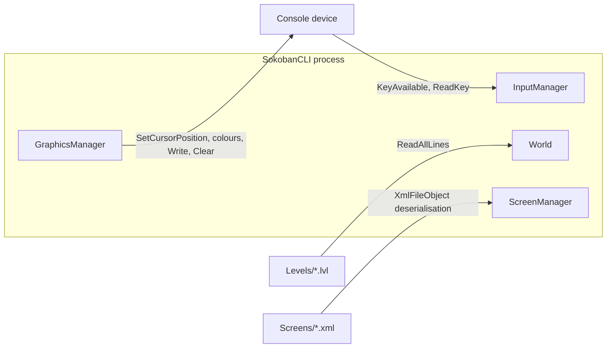

# Integrations

## Summary

SokobanCLI integrates with exactly three things at run time — the console device, level files, and screen definitions — and with two build-time systems: the .NET toolchain and GitHub Actions. There is no network, service, database, message broker, or third-party API integration, and none is planned in the code.

## Runtime integrations

### Console device

| Aspect | Detail |
|--------|--------|
| Direction | Bidirectional |
| Inbound API | `Console.KeyAvailable` polled once per frame, followed by `Console.ReadKey(true)` when a key is pending |
| Outbound API | `Console.CursorVisible`, `Console.SetCursorPosition`, `Console.BackgroundColor`, `Console.ForegroundColor`, `Console.Write(char)`, `Console.Clear`, and reads of `Console.WindowWidth`/`WindowHeight` |
| Owner | `InputManager` inbound, `GraphicsManager` outbound |
| Failure semantics | `KeyAvailable` throws on a console with no input buffer (redirected stdin); cursor positioning throws when the requested position is outside the buffer; a zero-size window produces zero-length framebuffers |
| Contract | The renderer relies on the console honouring per-cell colour changes and cursor positioning, which requires a real terminal or a compatible emulator |
| Coupling | Not abstracted. `GraphicsManager` calls `Console` directly, and `InputManager` may not reference `Graphics`, so no shared console abstraction exists today |

Two behaviours of the console device that the application depends on but does not control:

1. **Colour persistence between writes.** `GraphicsManager.Draw` sets both colours before each written cell and never resets them, so anything else writing to the console inherits the last colours used.
2. **The cursor.** `Program.Main` hides it; the renderer moves it explicitly. The application never restores its visibility.

### Level files

| Aspect | Detail |
|--------|--------|
| Direction | Inbound only |
| Location | `Levels/<n>.lvl` relative to the process working directory |
| Format | 14 lines of 14 characters, digits `0`–`6`, transposed so the line index is the grid X coordinate |
| Reader | `World` constructor via `File.ReadAllLines` |
| Validation | Line count and line length only; characters are not validated |
| Failure semantics | `FileNotFoundException` or `DirectoryNotFoundException` for a missing file or directory; `InvalidDataException` naming the file for a dimension mismatch; both unhandled and terminal |
| Lifecycle | Read on every `GameManager.Start`, i.e. on level load, restart, and advancement |
| Deployment | Copied to the output directory with `CopyToOutputDirectory=PreserveNewest` |

### Screen definitions

| Aspect | Detail |
|--------|--------|
| Direction | Inbound only |
| Location | `Screens/<TypeName>.xml` relative to the process working directory |
| Format | XML whose root element is the screen type name and whose child element names match screen and element property names |
| Reader | `XmlFileObject<Screen>` from the `NuciDAL` package, held as a single reused instance by `ScreenManager` |
| Validation | None. A missing file is tolerated (defaults are used); a malformed file throws |
| Failure semantics | `XmlException` or an IO exception, unhandled and terminal |
| Lifecycle | Read on the first `ScreenManager` construction and on every screen transition |
| Deployment | Copied to the output directory with `PreserveNewest` |

The `Screens/ScreenManager.xml` file is an empty root element that is copied but never read. Its presence suggests an earlier design in which the screen manager itself was configured from XML.

## The `NuciDAL` dependency

| Aspect | Detail |
|--------|--------|
| Package | `NuciDAL` 3.1.0, targeting `net10.0` |
| Used type | `XmlFileObject<Screen>` |
| Call pattern | `new XmlFileObject<Screen> { Type = someType }`, then `Read(path)` |
| Transitive dependency | `NuciExtensions` |
| Architectural consequence | The screen layer is coupled to a single mutable reader instance whose `Type` selects the deserialisation target, which is why two screens cannot be deserialised concurrently and why a lost `Type` assignment would silently deserialise into the wrong type |
| Replacement cost | The surface used is small — construct with a type, read a path, receive an instance — so replacing it with `XmlSerializer` would be contained to `ScreenManager` |

## Build-time integrations

| Integration | Purpose | Trigger | Permissions |
|-------------|---------|---------|-------------|
| .NET SDK 10 | Restore, build, test, publish | Local invocation; CI | None |
| NuGet.org | Package restore for `NuciDAL`, `Microsoft.CodeAnalysis.CSharp`, `NUnit`, `Moq`, `Microsoft.NET.Test.Sdk`, `NUnit3TestAdapter`, `TngTech.ArchUnitNET.NUnit` | Restore | None |
| `.github/workflows/dotnet.yml` | Continuous integration | Push and pull request to `master` | Default read |
| `.github/workflows/security.yml` | Vulnerability audit and CodeQL analysis | Push, pull request, weekly schedule | `security-events: write`, `contents: read` |
| `.github/workflows/github-release.yml` | Release build and asset publication | Published release | `contents: write` |
| `hmlendea/dotnet-release-scripts` (external) | Actual artefact construction for releases | Downloaded and executed by the release workflow | Runs with the workflow's write permission |

The release workflow fetches `https://raw.githubusercontent.com/hmlendea/dotnet-release-scripts/refs/heads/master/dotnet/<version>.sh` and pipes it into `bash`. This is the only point at which this repository executes code it does not contain, and the reference is to a branch rather than an immutable commit. See [security.md](./security.md).

## Explicitly absent integrations

| Not integrated | Evidence |
|----------------|----------|
| Network | No `HttpClient`, `Socket`, or `IPAddress` fragment in production sources; asserted by `RuleApplicabilityTests` |
| Database | No `EntityFramework`, `Dapper`, `SqlConnection`, `Npgsql`, or `DynamoDB` fragment; asserted by `RuleApplicabilityTests` and `ProjectReferenceTests` |
| Logging or telemetry service | No `NuciLog`, `ILogger`, `LogInformation`, `LogError`, or `TelemetryClient` fragment; asserted by `RuleApplicabilityTests` |
| Game framework | No `GuiImage`, `GuiText`, `GuiControl`, `Texture2D`, or `SpriteFont` fragment; asserted by `RuleApplicabilityTests` |
| Gamepad, mouse, or touch input | Only `Console.ReadKey` |
| Sound or audio | None |
| Persistence of any kind | No file writes anywhere |
| Localisation services | No resource files, locale directories, or translation infrastructure |
| Container registry or package registry | The production project is not packable; no image is published |
| Steam Workshop, Nexus Mods, or other distribution platform | Only GitHub releases |

## Integration seams for change

| If you need to… | The seam is |
|------------------|-------------|
| Render somewhere other than a console | Introduce a console abstraction referenced by both `Graphics` and `Input`; both currently call `Console` directly, and `Input` may not reference `Graphics`, so the abstraction must live in a namespace both may depend on |
| Read levels from a different location | `World`'s path construction; `Start(int level)` would need an additional parameter without breaking `IGameManager` |
| Serialise screens differently | `ScreenManager` only; the `XmlFileObject<Screen>` use is confined to two statements |
| Add analytics | Would violate the current privacy statement and `RuleApplicabilityTests`'s absence assertion; both would need to change intentionally |

## Related documents

- [dependencies.md](./dependencies.md) — every package with its purpose and consequence
- [build-and-deployment.md](./build-and-deployment.md) — the workflows in operational detail
- [components/graphics.md](./components/graphics.md) and [components/input.md](./components/input.md) — the console contracts