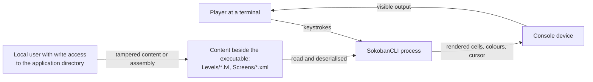

# Security

This document complements the root [SECURITY.md](../SECURITY.md), which states the reporting policy and the support window. It records what the application's actual security posture is, with the reasoning and the evidence.

## Threat model



## Assets

| Asset | Value | Exposure |
|-------|-------|----------|
| Nothing persistent | The application stores no data | None |
| The player's terminal session | An attacker with local access could already interact with it directly | None additional |
| The content files | A shared or multi-user installation could have its content modified by another user | Level and screen definitions |
| The `.lvl` and `.xml` encoding | A corrupted file degrades or crashes the application | Availability only |

The application has no credentials, no tokens, no user accounts, no personal data, no network boundary, no file writes, and no privileged operations. There is no data to exfiltrate and no privilege to escalate.

## Attack surface

| Surface | Reachable by | Consequence of abuse |
|---------|--------------|----------------------|
| `ScreenManager.CreateScreen` reflection | Content XML (`LinkId`, `LinkArgs`) | See below |
| `int.Parse(ScreenArgs[0])` | Content XML | `FormatException`, process termination |
| Level file parsing | Content files | Malformed dimensions throw; non-digit characters silently become empty tiles |
| Screen XML deserialisation | Content files | `XmlException`, process termination |
| Working directory | Whoever launches the process | A different directory means different content, so content resolution is a launcher responsibility |
| Console device | The terminal | The renderer writes escape sequences implicitly through `Console.SetCursorPosition` and colour properties |

## The reflection surface in detail

```csharp
Type screenType = Type.GetType($"{typeof(Screen).Namespace}.{screenName}")!;
Screen screen = (Activator.CreateInstance(screenType) as Screen)!;
```

Properties of this call:

- `screenName` comes from `UiMenuLink.LinkId`, which comes from `Screens/*.xml`.
- The name is constrained by prefix to `SokobanCLI.UI.Screens`. A prefix means a caller cannot name `System.Diagnostics.Process` and expect it to resolve, because the prefixed string `SokobanCLI.UI.Screens.System.Diagnostics.Process` resolves to nothing.
- The assembly-qualified form is also unusable through this code path for the same reason: appending an assembly name would produce a string starting with the namespace prefix.
- Therefore the practical surface is "any type in the `SokobanCLI.UI.Screens` namespace that derives from `Screen` and has a parameterless constructor". That set is exactly the screen classes in this repository.
- Nevertheless the constraint is incidental rather than designed: the root `ARCHITECTURE.md` records it as the widest surface in the application and recommends restricting it to the expected namespace if content ever becomes untrusted. Since the prefix already performs that restriction, the residual risk is that a future refactor removes the prefix.

Residual risk: a local attacker who can write to `Screens/TitleScreen.xml` can cause the application to instantiate any `Screens`-namespace type, and can supply arbitrary `LinkArgs` strings that reach `int.Parse`. Neither grants code execution beyond what the assembly already contains, and an attacker with write access to the application directory could replace the assembly outright, so the tampering scenario grants no capability the attacker lacks.

## Areas checked and found clean

| Concern | Finding |
|---------|---------|
| Hardcoded secrets, keys, tokens, or passwords | None. `RuleApplicabilityTests` and a repository-wide search find none |
| Credentials in configuration | There is no configuration and no credential store |
| Personal data collection | None. `PRIVACY.md` states this and the code confirms it: no user data is read, written, transmitted, or displayed |
| Network access | None. No `HttpClient`, no socket, no `IPAddress`. `RuleApplicabilityTests` asserts the absence of network fragments |
| Telemetry or analytics | None |
| File writes | None. `System.IO` is used only for `File.ReadAllLines` and `File.Exists` |
| Subprocess or shell execution | None |
| Deserialisation of untrusted types | `XmlFileObject<Screen>` deserialises into the declared `Screen` type only, so no type-name-driven instantiation occurs in the XML path |
| SQL or command injection | No database or command surface exists |
| Path traversal | `Path.Combine("Levels", level + ".lvl")` with an integer level cannot traverse; `Path.Combine("Screens", $"{Type.Name}.xml")` uses a compiler-derived type name |
| Unsafe code, P/Invoke, `DllImport` | None |
| Cryptographic use | None, and none needed |
| Dependency vulnerabilities | Audited by `.github/workflows/security.yml` on every push, pull request, and a weekly schedule via `dotnet list package --vulnerable --include-transitive`, plus CodeQL analysis for C# |

## Supply chain considerations

| Element | Assessment |
|---------|-----------|
| Production dependencies | One package, `NuciDAL` 3.1.0. A single dependency is a small surface; its own transitive dependencies (for example `NuciExtensions`) are included in the vulnerable-package audit |
| Build-time release helper | `.github/workflows/github-release.yml` downloads `https://raw.githubusercontent.com/hmlendea/dotnet-release-scripts/refs/heads/master/dotnet/<version>.sh` and pipes it into `bash`. The script is fetched from the moving `master` branch, not pinned to a commit, so its content can change without any change to this repository. The README warns readers to review external scripts before running them. This is the largest trust transfer in the repository, and it runs only in the release workflow with `contents: write` |
| Workflow permissions | `github-release.yml` requests `contents: write` (required to attach assets), `security.yml` requests `security-events: write` and `contents: read`, and `dotnet.yml` requests nothing beyond the default read access |
| Action pinning | Actions are referenced by major version (`actions/checkout@v7`, `actions/setup-dotnet@v5`, `github/codeql-action/*@v4`, `softprops/action-gh-release@v2`) rather than by commit SHA, so a compromised action tag would be honoured |
| Self-hosted runners | None; all workflows run on `ubuntu-latest` |

## Hardening opportunities, ranked

1. **Pin the release helper to an immutable reference.** Fetching from a branch means the executed code is whatever the upstream repository's default branch contains at run time. Pinning to a commit hash, or vendoring the script, would make the release artefact reproducible and the trust boundary explicit.
2. **Reallocate both framebuffers on a resolution change.** Not a security issue, but the current asymmetry turns a terminal resize into an unhandled exception, which is the most easily triggered crash an untrusted environment can cause.
3. **Constrain screen resolution to a known set.** Replacing `Type.GetType` with a registry of screen names would remove the reflection surface entirely and give a diagnostic instead of a null reference for an unknown name.
4. **Validate level content beyond dimensions.** Rejecting non-digit characters would convert a silent empty board into a clear error.
5. **Restore the terminal on exit.** Registering cleanup for cursor visibility and console colours would prevent a crashed run from leaving the terminal in a degraded state — a minor nuisance rather than a vulnerability.

## Non-findings explicitly recorded

- **No vulnerability from the reflection path** in the current deployment, because the content is repository-controlled and a local attacker with write access to the application directory already has equivalent capability. It is recorded as a design weakness, not an exploitable defect.
- **No vulnerability from the missing input validation**, because the only input is a trusted keyboard and the only content is read-only local files. The consequences are availability (crash, blank board), not confidentiality or integrity.
- **No vulnerability from the absence of authentication or authorisation**, because there is no protected resource. The word "player" denotes whoever sits at the terminal, and there is no notion of a session, account, or permission.
- **No vulnerability from `int.Parse` without a culture**, because the values are decimal integers with no culture-specific formatting.

## Related documents

- [SECURITY.md](../SECURITY.md) — the reporting policy and support window
- [PRIVACY.md](../PRIVACY.md) — the statement of no data collection
- [integrations.md](./integrations.md) — the console, content, and CI boundaries
- [ambiguities-and-open-questions.md](./ambiguities-and-open-questions.md) — open questions about the reflection surface